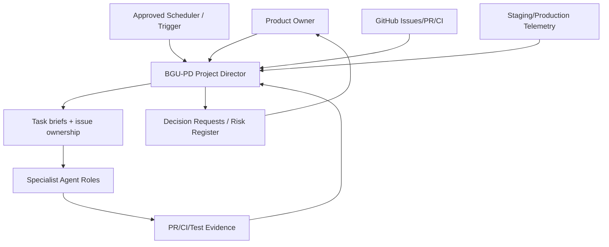

# Project Director — Monitoring, Reminder & Automation Specification
**Status:** Proposed, **not scheduled**.
**Goal:** BGU-PD coordinates specialist agents and informs Human Product Owner through project development, launch and post-launch using verifiable evidence.

## Operating architecture

## Inputs and permissions
- Read-only GitHub issues, PRs, commit status/checks (scoped repo).
- Optional connected calendar and reporting channel *only after user connects/authorizes*.
- Staging/production metrics via scoped observability provider; no direct production data mutation.
- Knowledge index: roadmap, design tokens, ERD, ADR, domain docs and human decisions.
- Durable workflow runtime with `run_id`, `last_success_at`, `source_cursor`, `idempotency_key`, `recipient`, `status`.

## Recurring job design (enable only after owner confirms)
| Workflow ID | Suggested trigger | Task | Notify when |
|---|---|---|---|
| PM-DAILY | Daily, local morning flexible time | pull issues, PR, CI, blocked tasks; draft concise report | scheduled output or significant blocker |
| PM-RISK | Weekdays | compare dependencies, overdue work, unreviewed PR and S0/S1 concerns | threshold breached; dedupe |
| PM-WEEKLY | Weekly, owner-selected day/time | steering summary: progress, forecasts, risk, next sprint decisions | scheduled |
| PM-RELEASE | release candidate created / manually triggered | go/no-go gate and release evidence | human approval required |
| PM-POST | D+1 and D+7 after actual production release | inspect health/incidents and followup tasks | meaningful change or scheduled |
| PM-LIVEOPS | Monthly | upcoming seasons/event content, published campaign audit | scheduled |

**Exact times and notifications are not configured by this documentation.** User confirms timezone, cadence, endpoint and permissions; only then create real task automation. Do not notify the owner from a pretend background agent.

## Job algorithm
1. Validate approved schedule and actor scopes.
2. Fetch authoritative evidence with timestamp and cursor; if unavailable, label UNKNOWN.
3. Compute current status against issue/PR/CI and tested staging/prod; never infer from agent chat text.
4. Check critical path, blocked tasks, risk changes, design/db/policy drift, school safety and cost assumptions.
5. Decide: digest, action-specific reminder or human escalation. Deduplicate within retention window.
6. Produce structured `PM-DAILY` or `PM-WEEKLY` report, attach links and next owner; persist run receipt and failure.
7. On failure, retry with backoff then alert human if job itself stops; keep no duplicate messages.

## Notifications to owner
- Routine: one concise daily/weekly briefing as configured, no excessive chatter.
- Blocker: explicit issue/PR, owner, impact and one requested decision.
- Critical: escalate promptly via actual approved notification mechanism; automated disable/freeze only if safety policy and capability explicitly allows.
- When no activity: `Không phát sinh thay đổi mới đã xác minh` rather than fabricated status.

## Postproduction expansion
Track uptime, multiplayer reconnect/latency, child safety moderation, wallet reconciliation, content publishing/asset failures, coding judge, game release compatibility and release costs. Quarterly product strategy: compare user outcomes to educational and entertainment goals; propose investments with measured evidence.

## Acceptance before scheduling
- [ ] GitHub connector read permissions and board/issue taxonomy verified.
- [ ] User chooses local timezone, reminder/digest times, channel and privacy scope.
- [ ] Test dry-run with sample issues and no student data.
- [ ] Report has actual evidence refs and caveats.
- [ ] Recurring task created with scheduler confirmation (not just agent prompt).
- [ ] Owner can pause/cancel schedule.
