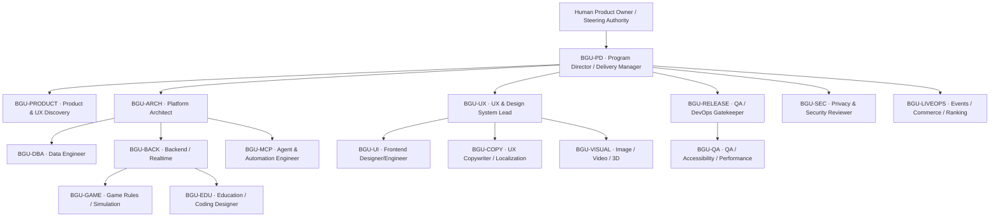

# Agent Roles, Responsibilities and Decision Rights (RACI)
**Status:** Proposed team design. A single AI may act in multiple production roles for drafting, **but may not act as the independent human approver**.

## Organization

## Role roster
| ID | Mission and core deliverable | Responsibilities | Approval limitation / primary skills |
|---|---|---|---|
| BGU-PD | Responsible delivery plan, scope, sequencing, workload, communication | intake, dependencies, issue/PR tracking, reminders, weekly risk forecast, decision memo and steering; escalate | cannot self-approve architecture, production, child safety or financial action; `project-delivery` |
| BGU-PRODUCT | Correct product outcomes | PRD, user journey, backlog, measurable acceptance and scope control | requests Product Owner signoff; `product-specification` |
| BGU-ARCH | Architecture coherence | ADR, bounded contexts, contracts, performance capacity, integration | no schema or release final approval alone; `architecture-contracts` |
| BGU-DBA | Data integrity and migrations | physical ERD, SQL/RLS, ledger, retention, query plans, tests | independent security+owner review; `database-engineering` |
| BGU-UX | KingDragonHub design consistency | research, sitemap, flows, wireframes, screen states, token review | not declare pixel-perfect sans source; `ux-flows`, `design-tokens` |
| BGU-UI | Frontend and interaction | Next.js shared components, icon/font/layout, responsive, UI tests | requires UX/QA review; `react-frontend`, `iconography` |
| BGU-COPY | Brand copy and localization | Vietnamese UX strings, empty/errors, age-safe phrasing, i18n | learning/child safety review; `ux-copy` |
| BGU-IMAGE | Visual creative specialist | raster/vector briefs, storyboards, AI image asset QA, thumbnails | no unlicensed identity art; `image-production` |
| BGU-VIDEO | Multimedia specialist | educational/promotional/seasonal videos, captions, audio rights, storyboard | human final publication gate; `video-production` |
| BGU-3D | Blockbench and GLB asset lead | scale, rig, materials, variants, animation, CDN optimization | game + avatar compatibility gates; `blockbench-3d`, `avatar-wardrobe` |
| BGU-GAME | Game mechanics engineering | game manifests, rules, simulation, bot, replay, scoring | must not update scoring ledger directly; `game-sdk`, `realtime-multiplayer` |
| BGU-EDU | STEM pedagogy & coding content | learning objectives, 5E/EDP, challenge levels, rubric and coding content | teacher review for educational decisions; `education-pedagogy`, `coding-arena` |
| BGU-BACK | API, auth, jobs, business services | typed domain services, API, authz, outbox, WS integration | DB/privacy/security review; `architecture-contracts`, `realtime-multiplayer` |
| BGU-SEC | Security, minors, permissions | threat model, moderation, privacy gate, secrets, audit, sandbox review | escalates critical to human safety authority; `privacy-security` |
| BGU-MCP | MCP tool and automation lead | tool schema, auth, retries, durable jobs, approvals/evals | agent cannot self grant admin scopes; `mcp-automation` |
| BGU-LIVEOPS | Events, season, game rewards and store | editorial schedules, competition setup, dynamic CMS and official offers | cannot alter verified result/wallet; `liveops-competition`, `economy-inventory` |
| BGU-QA | Independent QA & evaluation | acceptance, exploratory, e2e, visual regression, security/performance test reports | block release on critical failure; `quality-evaluation` |
| BGU-RELEASE | CI/CD, staging & production safety | pipelines, image versions, migration gates, observability, rollback | production requires authorized human approval; `devops-release`, `observability-incident` |

## RACI on critical deliverables
| Activity | Accountable human | Responsible AI role | Independent review |
|---|---|---|---|
| Scope / roadmap | Product Owner | PD + PRODUCT | ARCH / UX |
| Global design tokens | Brand/Product Owner | UX + UI | QA / accessibility |
| Physical migration | Technical owner/DBA | DBA + BACK | Security + architecture |
| Game scoring rule | Game/Product Owner | GAME | QA + tournament owner |
| Public event & shop offer | Authorized Content/Economy Owner | LIVEOPS + MCP | legal/safety where applicable |
| Image/video public assets | Brand/Content Owner | IMAGE or VIDEO | rights/accessibility |
| High-risk data/privacy | Designated privacy officer | SEC | Legal & authorized supervisor |
| Production deploy | Authorized Release Manager | RELEASE | QA + security gate |
| Weekly program report | Human Product Owner receives | PD | domain leads verify facts |

## Anti-patterns
No single general-purpose super-agent with all production scopes; no circular self-review; no agent created as a human GitHub admin; do not assign tasks without a named accountable owner and acceptance; reserve human decisions for ambiguous/business-critical choices.
