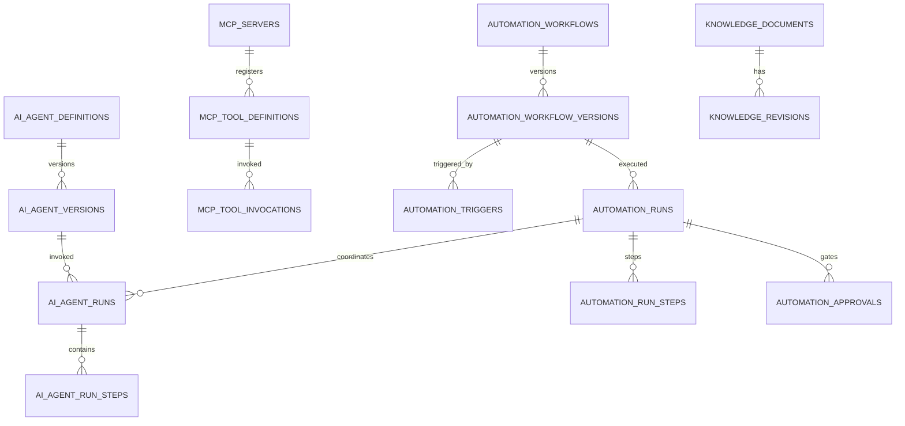

# BOARD GAME UNIVERSE — AI/MCP/Automation Data Architecture v1.1

**Design status:** Additive logical schema; không thay thế 159 bảng nền tảng v1.0. Các bảng dưới đây là **ứng viên**; gom/tách sau ADR và migration review. Không tạo tất cả trước khi có use case. Tên `snake_case`, UUID, timestamptz UTC, immutable revisions, tenant isolation.

## 1. Domain ownership & identity

Principal identities:
- `users`: con người, có tư cách/membership.
- `agent_identities`: identity riêng của Agent + owner + trạng thái cấp quyền, **không phải** user giả danh giáo viên.
- `service_principals`: tác vụ tự động máy-máy, owner của lịch/job, credential rotation.
- `mcp_oauth_grants`: delegated grants với actor/tenant/scope/audience/expiry; lưu reference đến secret vault chứ không lưu token plaintext.
- `approval_decisions`: xác nhận của reviewer, liên kết bản băm payload và revision.

`effective_rights` phải luôn giới hạn bởi grant ∩ role ∩ policy ∩ data classification ∩ current membership ∩ tool scope. Cron/job không kế thừa quyền người đặt lịch sau khi người đó bị thu hồi; workflow cần kiểm tra lại active sponsor/service grant trước mỗi bước thay đổi dữ liệu.

## 2. Candidate tables: AI Platform Core

| Table | PK/FK trọng yếu | Index/uniqueness | Retention & responsibility |
|---|---|---|---|
| `ai_agent_definitions` | id, owner_org_id?, code, state | unique (owner_org_id,code) | Agent registry |
| `ai_agent_versions` | id, agent_id, version, spec_json, spec_sha | unique (agent_id, version) | Immutable; review model/tools/prompts |
| `ai_agent_identities` | id, agent_id, service_principal_id?, owner_user_id? | status | Revocation and ownership |
| `ai_agent_runs` | id, agent_version_id, initiated_by, tenant_id, workflow_run_id? | (tenant_id,created_at), trace_id | Logs redacted by class |
| `ai_agent_run_steps` | id, run_id, sequence, kind, status, artifact_id? | unique(run_id,sequence) | Replay/run audit, no raw sensitive payload |
| `ai_eval_suites` | id, owner_id, version, rubric_json | unique(owner_id,version) | AI quality governance |
| `ai_eval_results` | id, suite_id, agent_version_id, outcome | suite/time index | Benchmark trends |
| `ai_cost_ledger` | id, run_id, model_provider, usage_units, estimated_cost | tenant/day index | Cost & quota, no PII |

## 3. Candidate tables: MCP & external connectors

| Table | PK/FK | Index / constraint | Purpose |
|---|---|---|---|
| `mcp_servers` | id, owner_org_id?, endpoint, protocol_versions | endpoint + status | Server registry, allowlist |
| `mcp_tool_definitions` | id, server_id, name, contract_version, schema_sha | unique(server_id,name,contract_version) | Audited contracts; risk levels |
| `mcp_tool_permissions` | id, tool_definition_id, permission_code, approval_policy_id | unique(tool_definition_id,permission_code) | Permission mapping |
| `mcp_client_registrations` | id, oauth_client_id, owner_org_id, grant_type | unique(oauth_client_id) | Approved clients |
| `mcp_oauth_grants` | id, client_id, principal_id, resource, scope_set, secret_ref | unique constrained grant + expires/revoked | OAuth delegated grants |
| `mcp_external_connections` | id, org_id, provider, credential_secret_ref, status | unique(org_id,provider,logical_name) | GitHub/Blockbench/etc |
| `mcp_tool_invocations` | id, tool_id, actor_ref, org_id, request_digest, result_status | request_id unique, org/time | Sensitive audit w/ minimal payload |
| `mcp_resource_catalog` | id, owner_domain, resource_uri_template, policy_id | uri template unique | Resource allowlist |
| `mcp_schema_revisions` | id, contract_id, revision, sha256 | unique(contract_id,revision) | Schema interoperability |

## 4. Candidate tables: Automation & human approval

| Table | Keys and relationships | Consistency constraint | Purpose |
|---|---|---|---|
| `automation_workflows` | id, owner_org_id?, code, owner_principal_id | unique(org_id,code) | Logical workflow |
| `automation_workflow_versions` | id, workflow_id, version, graph_json, sha | unique(workflow_id,version) | Immutable step graph |
| `automation_triggers` | id, workflow_version_id, trigger_type, config_json | only active trigger allowed | Schedule/domain event/webhook |
| `automation_schedules` | id, trigger_id, timezone, rrule, next_at | index(next_at) WHERE enabled | Durable calendar |
| `automation_runs` | id, workflow_version_id, trigger_event_id?, idempotency_key | unique(workflow_version_id,idempotency_key) | Run FSM & sponsor snapshot |
| `automation_run_steps` | id, run_id, step_key, attempt, state, input_digest | unique(run_id,step_key,attempt) | Checkpoints and retries |
| `automation_job_artifacts` | id, run_id, file_asset_id, checksum, class | run_id index | Inputs/outputs with TTL |
| `automation_approvals` | id, run_id, action_name, payload_sha, reviewer_scope | unique(run_id,action_name,payload_sha,approval_round) | Authorized review decisions |
| `automation_compensations` | id, run_id, original_step_id, compensating_command | unique(original_step_id,compensation_version) | Reverse effects where possible |
| `automation_job_queue` | id, run_step_id, available_at, lease_token, attempts | index(available_at) | If using DB queue; else external queue |
| `automation_dead_letters` | id, failed_step_id, class, explanation, retry_policy | status/time | Operational manual review |

## 5. Candidate tables: Knowledge & policies

| Table | Important fields | Governance |
|---|---|---|
| `knowledge_documents` | id, org_id?, source_kind, owner, classification | source provenance |
| `knowledge_revisions` | id, document_id, sha256, signed_at, schema_version | immutable versions |
| `knowledge_chunks` | id, revision_id, chunk_index, source_range | no indexing raw child PII by default |
| `knowledge_acl` | id, doc_id, actor_type, resource_scope, permission | enforced on every retrieval |
| `ai_policy_versions` | id, code, revision, rules_hash, decision_status | security-approved immutable policy |
| `ai_approval_policies` | id, risk_level, operation_class, review_rules | approvals default-deny |
| `ai_safety_incidents` | id, run_id?, severity, privacy_class, assigned_owner | legal retention + response |

**Total additive candidate tables in this dictionary: 8 + 9 + 11 + 7 = 35** (review before physical DB design). Existing generic tables (`domain_outbox`, `audit_logs`, `assets`, `policy_sets`) MUST be reused instead of duplicating by default. Physical schema may have fewer tables after consolidation.

## 6. Critical relationships (logical)

## 7. Data classification and deletion

- `agent_runs` and MCP tool calls store *metadata + redacted content*; use encrypted object storage with strict TTL for sensitive debug artifacts if absolutely necessary. No secrets in logs, traces, prompts, or knowledge chunks.
- Store trace/correlation IDs, identity, authorization decision, exact tool/schema revision, sanitized arguments hash, output artifact hash, proposal ID, approval link, cost usage, outcome, lifecycle transitions.
- Scope all tenant-owned rows by tenant id. For global tools, explicit platform principal required; do not use null tenant to bypass tenant checks.
- Retention matrix varies by domain: security audits, student assignments, chat, temporary AI prompts, campaign drafts and public catalog require different rules; owner approves before deployment. Right-to-delete workflows must include AI traces and vector retrieval indexes.
- Immutable audit entries protected from accidental deletion while preserving legally required disposal schedules; deletion may use cryptographic erasure or anonymization where permitted after legal review.

## 8. SQL constraints required before launch

- `UNIQUE(workflow_version_id,idempotency_key)` for run duplicates; `UNIQUE(run_id,step_key,attempt)` for execution ledger.
- `UNIQUE(tool_id,request_id)` / `UNIQUE(external_event_id,consumer)` for dedupe.
- `CHECK status IN ...` for run and approval FSM.
- `approval.payload_hash == canonicalized(proposal.payload)` + expected revision and expiry checked **within command gateway transaction**.
- Token grant must not be valid after `revoked_at` or expiration; active service principal checked each run.
- Row Level Security policies and negative tenant tests for restricted data.
- Bulk operations enforce max recipients/items, with preflight counts and explicit approval.

## 9. Migration strategy

Phase P0: `mcp_servers`, `mcp_tool_definitions`, `ai_agent_definitions`, `ai_agent_versions`, `mcp_tool_invocations`, `automation_approvals` (minimum implementation based on use case).

Phase P1: durable workflows, schedules, runs/steps, external connections, job artifacts, quota/usage.

Phase P2: knowledge indexed search, evals, cross-provider execution, advanced incident handling.

Phase P3: tenant-specific agent marketplace/custom MCP apps. Do not materialize the entire 35-table inventory in a single migration.