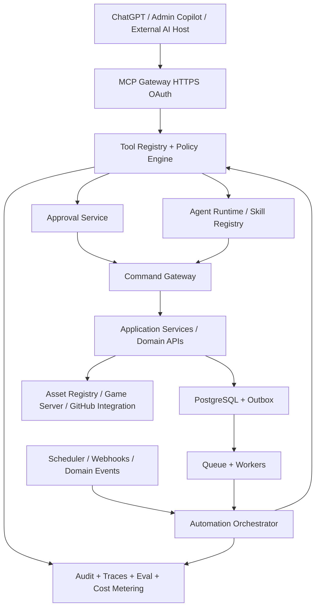

# BOARD GAME UNIVERSE — MCP & AI Agent Control Plane v1.1

**Status:** Architecture specification, **not implemented**. **Baseline:** MCP protocol `2026-07-28`, TypeScript MCP SDK v2, backward compatibility `2025-11-25` only by validation. **Owner:** Platform Architecture + AI Platform + Security + Operations. **Update:** 09/10/2026.

## 0. Quyết định bắt buộc (Architecture Decision)

AI/MCP/Automation không phải plugin trang trí. Chúng là **đường truy cập chuẩn hóa có kiểm soát** của toàn hệ thống, tồn tại ngay từ Phase 0. Mục tiêu: operator có thể dùng ChatGPT, internal AI copilot, CI agents hoặc lịch chạy định sẵn để lập kế hoạch, đọc, tạo, kiểm định, phê duyệt và phát hành nội dung xuyên nhiều bounded contexts.

Nguyên tắc quyết định:
1. **Domain services là nguồn sự thật.** UI, REST API, MCP tools và automation gọi cùng application services; không trực tiếp ghi DB/bỏ qua validator.
2. **AI autonomy có cấp độ.** Read → Draft → Simulate → Review → Commit → Publish/Deploy; Agent không tự phê duyệt chính yêu cầu của mình.
3. **Client-agnostic.** MCP server không phụ thuộc ChatGPT; các host khác kết nối khi được kiểm chứng. Không phụ thuộc tương thích chưa được test của bất cứ MCP host nào.
4. **Machine identity + user delegation.** Phân biệt human requester, delegated token, service account, agent identity và tổ chức/scope của hành động; effective privileges = giao của các quyền, không phải hợp các quyền.
5. **Versioned & deterministic.** Tool contract, workflow definition, agent prompt, knowledge snapshot, model config, game/artifact revision, approval policy version phải có thể truy vết.
6. **Jobs durable.** MCP chỉ là giao thức công cụ; scheduler, job states, retries và outbox nằm trong platform. MCP Tasks extension cung cấp giao diện task bất đồng bộ nếu client hỗ trợ.
7. **Safe for minors.** Không tự động công bố dữ liệu học sinh, chat riêng, thông tin nhận dạng, kết quả học tập cá nhân; người giám sát và policy bắt buộc.

## 1. Architecture boundaries



- **MCP Gateway (northbound):** stateless HTTP `/mcp`; xác thực OAuth, xác nhận audience, scopes, org/resource authorization; công bố subset tools/resources/prompts theo chính sách.
- **MCP Client Hub (southbound):** kết nối MCP servers của GitHub/Blockbench/Blender/Godot/Canva (nếu được cấp phép); allowlist origin, tool scopes, credential vault, egress restriction. Các connector bên ngoài không được quyền ngầm truy cập dữ liệu trẻ em.
- **AI Agent Runtime:** planner + specialists + context retrieval + guardrails; agent output là đề nghị cần kiểm chứng, không mặc nhiên đúng.
- **Workflow Engine:** durable run ID, state transitions, retries, cancel, timeout, scheduler, condition rules, compensation, human gates.
- **Command Gateway:** chung cho REST/Admin/MCP/Automation; validate, authorize, idempotency, expected_version, transactional outbox.
- **Job Workers:** generation of content/media/asset, builds/tests, report, tournament recalculation, notifications; isolates workload according to trust.
- **Audit/Observability:** run timeline, correlation/trace ID, policy decision, approval, before/after diff, artifact versions, error, model cost. Không log prompt hoặc tool result có PII theo mặc định.

### 1.1 Các interface bắt buộc

| Interface | Owned by | Exposes | Không làm |
|---|---|---|---|
| `/mcp` | AI platform | MCP tools/resources/prompts | Không sở hữu nghiệp vụ game |
| `/api/...` | Platform backend | HTTP operations | Không xử lý code người dùng trong process |
| `DomainApplicationService` | Bounded context | Commands/queries + events | Không chấp nhận raw SQL từ agent |
| `AgentRunService` | AI platform | Start/pause/resume/cancel + progress | Không tự phê duyệt thay người |
| `AutomationService` | Operations | schedules, triggers, workflow runs | Không xem lịch là lời cấp quyền |
| `ApprovalService` | Security/Governance | proposal hash, reviewer decision | Không dựa vào lời nói "đã duyệt" trong prompt |
| `IntegrationBroker` | Integration | delegated external connectors | Không truyền tiếp bearer token tùy ý |

## 2. MCP protocol & compatibility

- Dùng MCP `2026-07-28`, SDK v2 (`@modelcontextprotocol/server`, `@modelcontextprotocol/client`), HTTPS Streamable HTTP. Phiên bản này bỏ handshake `initialize` và MCP session ID cho yêu cầu mới; các request độc lập và self-describing. Hỗ trợ clients `2025-11-25` ở adapter tương thích riêng sau conformance test, không cố ép 2026 session semantics vào 2025.
- **Tools:** hành động kiểm soát được; **Resources:** đọc PRD/GDD, game catalog, schema, workflow state; **Prompts:** quy trình/mẫu tác vụ versioned và quyền rõ. MCP Skills extension có thể đóng gói `SKILL.md` để điều khiển workflow phức tạp nhưng không được coi là căn cứ cấp quyền.
- Đối với long-running tool: dùng own durable Job ID + status/result resources; MCP Tasks extension `io.modelcontextprotocol/tasks` nếu client hỗ trợ: `tasks/get`, `tasks/update`, `tasks/cancel`. Nếu không hỗ trợ, trả job handle và cung cấp `jobs_get_status` + `jobs_get_result`.
- Tool result phải có cấu trúc, giới hạn kích thước, paging, redaction; error code có tính máy đọc được; `tools/list` có thể cache theo security context nhưng **không cache công khai danh sách công cụ phụ thuộc quyền**.
- Auth: OAuth 2.1/OIDC via IdP; OAuth resource server: validated issuer/audience/expiry/scopes, metadata RFC 9728, PKCE cho client tương tác, separate client credentials/service identity cho automation, rotations/revocations; reauthorize trước sensitive action.

**Official technical references:** https://blog.modelcontextprotocol.io/posts/2026-07-28/ ; https://ts.sdk.modelcontextprotocol.io/v2/ ; https://ts.sdk.modelcontextprotocol.io/v2/serving/authorization ; https://tasks.extensions.modelcontextprotocol.io/specification/2026-07-28/tasks

## 3. Phân tầng công cụ & rủi ro

| Level | Ví dụ | AI autonomy | Required controls |
|---|---|---|---|
| R0 Read | game catalog, campaign calendar, aggregate metric | Tự động trong granted scope | Tenant filter, PII redaction, rate limit |
| R1 Draft | create announcement draft, generate GDD, prepare quiz | Tự động trong workspace nháp | Schema validation, versioning, attribution |
| R2 Reversible restricted | edit unpublished campaign, schedule staging dry-run | Có điều kiện theo template/operator policy | Snapshot, diff, idempotency, approval policy |
| R3 Publish/external effects | publish public event, notify all schools, change score rules | Explicit human approval (hoặc pre-approved bounded workflow nếu chính sách cho phép) | Dual control theo risk, recipient preview, evidence |
| R4 Critical/destructive | delete student records, schema migration prod, change permissions, transfer ownership, send private info | **Manual operational workflow; AI chỉ soạn phương án** | Security/privacy owner, verified operator, backup, break-glass controls |

Các tool công bố rõ `risk_level`, `permission`, `scope`, `approval_mode`, `side_effects`, `idempotent`, `dry_run_supported`, `data_classification`, `owner_domain`, `input/output_schema_version`.

Mẫu trạng thái command: `requested → validated → prepared → awaiting_approval → approved → executing → succeeded | failed | canceled | compensating`. Approvals gắn hash dữ liệu dự kiến, đúng actor/resource/version/expiry/intent; khi payload khác phải xin lại. Review qua UI tin cậy, không phải text do LLM tự tạo.

### 3.1 Execution context (server-derived; không tin nguyên giá trị client gửi)

```json
{
  "request_id": "uuid",
  "actor_type": "human_delegated",
  "human_user_id": "uuid",
  "agent_identity_id": "uuid",
  "oauth_client_id": "mcp_client_id",
  "tenant_id": "uuid",
  "active_scope": {"type": "organization", "id": "uuid"},
  "role_assignment_id": "uuid",
  "permission_snapshot_id": "uuid",
  "policy_revision_id": "uuid",
  "approval_id": null,
  "trace_id": "traceparent",
  "correlation_id": "uuid"
}
```

Tenant/actor được dẫn xuất và kiểm chứng từ claims + membership; agent input không được tự chọn tenant mà chưa được phép. `scope_id` trong arguments dùng để chọn resource, không phải để cấp quyền.

## 4. Agent orchestration

| Agent role | Scope | Allowed autonomy | Human owner |
|---|---|---|---|
| Orchestrator / Planner | Breakdown, dependency, progress | Read/draft; dispatch | Product Lead |
| Game Design Agent | GDD, rulepacks, balancing tests | Draft/test/simulate | Game Design Lead |
| Asset Agent | Blockbench briefs, GLB QA, manifests | Draft/asset staging | Art Lead |
| Coding Agent | isolated feature branches, unit tests, PR | Dev/test/PR only | Tech Lead |
| QA / Evaluation Agent | test cases, regression, accessibility | Auto test + report | QA Lead |
| Content / LiveOps Agent | banners, themes, game collections, campaigns | Draft/schedule after authorization | Content Lead |
| Tournament Agent | registration, fixtures, scoring previews | Preview/prepare; referee/organizer approval | Tournament Director |
| Education Agent | lessons, standards, assessments | Draft/mapping; teacher review | Academic Lead |
| Moderation Assistant | triage risky content | Flag/redact/recommend; not irreversible sanction alone | Safety Officer |
| Data & Analytics Agent | aggregate insights, anomaly alerts | Scoped read; proposals | Data Steward |
| DevOps Agent | logs, build health, incidents, rollback plan | Read/diagnose/staging actions | SRE |
| Automation Designer Agent | workflows, schedules, trigger policies | Draft & simulate; publish after approval | Ops Lead |

Không agent nào có permanent unrestricted credentials. Chia `agent_definitions` (versioned skill, model, instruction, tools, budget) khỏi `agent_runs` (execution instance). Điều phối giữa agents qua orchestration/workflow, không dùng chat tự do làm nguồn trạng thái nghiệp vụ.

## 5. Automation engine

### Triggers
1. Manual command: người quản trị yêu cầu bằng chat / admin UI.
2. Time/calendar: ngày, giờ, tháng, sự kiện theo timezone của tổ chức, RRULE/cron có DST policy.
3. Domain event: `game.release_approved`, `event.registration_closed`, `match.finalized.v1`.
4. Condition watch: threshold, KPI, health status, deadline, anomaly.
5. Webhook/integration: GitHub PR merge, asset build complete, external approved provider event (signed).
6. Batch/data import: course CSV verified, seasonal config change.

### Workflow lifecycle
`draft → linted → simulation_passed → approved → active → suspended/retired`. Run lifecycle: `queued → running → waiting_approval/waiting_external → succeeded/failed/canceled`. Store check-point after steps; reentrant/idempotent. Human gates timeout safely, default reject. Retry with exponential backoff for transient errors; non-retryable errors move to review queue. Critical actions require compensation plan and preconditions.

### 5.1 Event processing
- Domain event committed with outbox; dispatcher invokes durable workflow. No workflow depends on AI live availability for critical business transactions.
- Scheduler stores authoritative next run time; independent worker wakes task. Time-based content publishing/expiry MUST be deterministic (no model call required unless optional generated draft).
- AI is used for synthesis, design, review and planning. Deterministic source of truth computes score, reward, permissions, registration rules, legal date/time and user entitlements.
- Limit agent budget: cost ceiling per run/day, max tool calls/recursion/time, quota by tenant, model fallback, circuit breaker, stop switch.

## 6. Developer operations via MCP

Natural-language request to upgrade a game follows:
`Create change request → produce spec → ephemeral branch/workspace → coding agent patch → tests + schema/asset checks → security policy → PR → required human CODEOWNERS approval → CI/CD staging → QA acceptance → controlled production release → monitor/rollback`.

Prohibited: agent push to protected main, edit production secrets, run unapproved migration, deploy critical changes unattended, bypass CI, manipulate tournament results. Game SDK version and state migration must be pinned; compatibility report included in PR.

## 7. Security & reliability threat model

| Threat | Boundary / Mitigation |
|---|---|
| Prompt injection in chat/community/posts/files/asset names | Treat retrieved strings as untrusted data; never as instructions; sanitize tool descriptions/results; explicit instruction hierarchy; restricted tools |
| Cross-tenant reads | claims validation + tenant-scoped policy + RLS/service checks + negative tests |
| Agent privilege escalation | effective permission intersection; no token passthrough; no arbitrary SQL/shell outside sandbox |
| Mass notification/publish mistakes | recipient preview; volume limits; approval token bound to campaign revision; rollback/recall where possible |
| Unapproved payments/data deletion | R4 manual; dual approval; audit, backup and retention/legal check |
| Poisoned coding submissions/UGC | isolated sandbox; no outgoing network/secret mounts; anti-zip bomb, file scanning |
| Tool name/description poisoning | Registry review, integrity signature, controlled installation, provenance |
| Job retry duplicate effect | idempotency key, outbox/inbox dedupe, workflow step ledger |
| Compromised external MCP | allowlist, per-connector vault token, audience-bound auth, minimal egress, connector disable |
| Sensitive traces | default redaction; per-tenant retention; encrypted storage; restricted access |
| Agent runaway cost | budget, quotas, loop/step limits, auto suspend |
| Stale approval | expected resource revision/hash, approval expiry, reviewer authority recheck at commit |

Do not use MCP descriptions, system prompts, markdown from users, or agent self-claims as authorization decisions. For protected child/student data, no RAG index of raw PII by default; consent and retention handling include embeddings, logs and backups.

## 8. AI Operations Center screens

1. **Agent Registry:** definitions, model/provider, version, permitted tools, owner, budgets, evaluation state.
2. **MCP Tool Registry:** servers, capabilities, schemas, scopes, cert/health, compatibility, risk, sample calls.
3. **Connection Center:** external connector link/OAuth, delegated grants, last usage, rotate/revoke.
4. **Workflow Builder:** triggers, conditional branches, tasks, guards, approvals, rollback, templates.
5. **Automation Calendar:** next executions, disabled/enabled, timezone, exclusions, concurrency caps.
6. **Runs & Trace Explorer:** operator, context, sub-agent calls, tool I/O redacted, errors, artifacts, token cost.
7. **Approval Inbox:** diff, audience, risks, before/after, expires, approve/reject/revisions.
8. **Content Release Studio:** preview website/mobile, schedule, publish, expire, rollback.
9. **Agent Evaluation:** offline golden tests, live shadow evaluation, tool precision, hallucination incident, quality gates.
10. **Safety & Governance:** policies, tenant data controls, audit, PII access review, incident triage.

## 9. Source layout additions

```text
apps/
  mcp-gateway/                # remote MCP protocol adapter
  agent-orchestrator/         # run orchestration service
  automation-worker/          # durable execution / cron / event trigger
  ai-ops-console/             # administrative AI operations UI
packages/
  mcp-contracts/              # tool manifests, zod/json schemas, compatibility
  mcp-policy/                 # OAuth claims, scope, RBAC/ABAC, approval
  agent-sdk/                  # agent definitions, limits, execution context
  workflow-engine/            # versioned workflows, checkpoints, retries
  ai-evals/                   # tests, red-team prompts, quality baselines
  integration-broker/         # external client connections + secrets
  knowledge-index/            # signed/revisioned searchable documentation
  audit-events/               # redacted structured audit events
integrations/
  github/ blockbench/ godot/ blender/ canva/
workflows/
  monthly-theme/ tournament/ game-release/ content-refresh/
  asset-pipeline/ teacher-assignment/ nightly-health/
```

Separation of concerns: MCP adapter can be replaced without changing domain service. External integration packages implement stable interfaces; AI agents cannot import raw database client into their tool code.

## 10. Delivery milestones and gates

| Stage | Deliverables | Exit criteria |
|---|---|---|
| AI-0 (Phase 0) | ADR, threat model, policy matrix, tool standards, governance | Approved tool/actor data model |
| AI-1 Foundation | MCP Gateway OAuth, read-only tools, agent registry, audit, inspector | Cross-tenant denied; token audience validated; traces redacted |
| AI-2 Draft & Approval | CMS draft tools, proposals/diffs, human approval inbox | Cannot publish without fresh matching approval |
| AI-3 Automation | durable scheduler, domain event triggers, idempotency, status | Resume after worker restart; no duplicate publish |
| AI-4 Specialist Agents | Content, Event, Game, Asset agents + workflows | Golden evals and scoped permissions pass |
| AI-5 Dev/Release | GitHub PR, CI checks, staging, rollback guards | Agent cannot merge protected branch or self-approve |
| AI-6 Ecosystem | Coding challenge & future plugins, tenant agent marketplace | Sandboxes, licensing and owner approvals |

Release gates: tool schema validation; authz negatives; replayability; approval tampering test; kill-switch; incident response; load test; privacy review.

## 11. KPIs for AI platform

- Tool success and **authorized denial correctness**; % tool requests blocked appropriately.
- % agent tasks completed with evidence and without human rework; QA acceptance for content.
- Time from request to approved draft/published content; schedule execution delay.
- Approval turnaround + stale/conflicting approval detection.
- Idempotency duplicate suppression; job resume success after restart.
- Model tokens/cost by tenant/agent/workflow and error budget.
- Security incidents, sensitive data exposure rate (target zero) and remediation time.

## 12. Explicit non-goals at first release

No unrestricted autonomous production changes; no raw SQL MCP tool; no agent-to-agent unverified credential delegation; no public MCP tool writing student PII; no arbitrary web shell on production; no fully automated moderation sanctions for minors; no self-modifying policy engine via LLM. These can be reconsidered only within audited, operator-approved bounded systems, not as defaults.