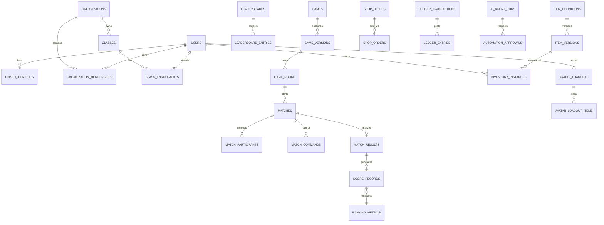

# Database Freeze Readiness V2 — Domain Ownership and Physical Schema Plan
**Status:** Proposed, NOT FROZEN; requires Product, Platform, Privacy and Data signoff. **DB:** PostgreSQL.
**Inputs:** v1 159 logical table inventory, AI 35 candidate logical tables, pending PR #3 economy inventory, 20 end-to-end flows and 117 logical screens.

## 1. Why a DB freeze is not yet safe
The v1 inventory is broad, but several user journeys reveal **new aggregate boundaries** and inconsistencies in names. Do not apply a mega-migration merely because a 159-table inventory exists. Freeze one tested P0 physical subset and explicit extension points for future shopping/social/coding.

**Freeze artifacts:** ERD + data dictionary v2, exact SQL migrations, sample seed, FK/unique/index, RLS/authorization contract, workflow state table, command/event schema, retention matrix, restore plan, test evidence.

## 2. Source-of-truth and naming rules
- Singular domain names in docs; PostgreSQL physical table names plural `snake_case`, stable UUID primary keys, time fields `timestamptz` UTC.
- Provider identity `auth_subject` is NOT `users.id`; use platform UUID and mapping to existing KingDragonHub identity.
- Canonical names follow the existing main data dictionary unless an ADR explicitly changes them. In particular `game_rooms` ≠ `matches`; `classroom_sessions` ≠ `auth_sessions`; `event_programs` ≠ `domain_outbox` events.
- Commands and all tool operations authorize against domain services; frontend/agents never own authoritative scores, wallet balances, ownership or minor visibility.
- `jsonb` allowed for a versioned immutable game-state payload, theme token config and verified dynamic game content, not generic polymorphic relational shortcuts.
- Use `tenant_id/organization_id` appropriately; personal user global identity is not owned by a school. Tenant-scoped business tables require composite uniqueness and explicit scope in queries.
- Soft-delete UX is distinct from verified legal deletion/anonymization and accounting audit retention.

## 3. Proposed domain ownership (bounded contexts)
| Domain | Owns writes | Exposes service contract / events | Dependency |
|---|---|---|---|
| Identity | users, external identities, private profile | identity.created, identity.restricted | OIDC/KingDragonHub |
| IAM/Tenant | orgs, memberships, assignments, policies | member.added/revoked | Identity |
| Game Catalog | games, immutable releases, capabilities | game.published | Assets |
| Runtime | game_rooms, matches, commands, snapshots | match.finalized | Game Catalog |
| Persistent World | world state and revisions | world.updated | Runtime + Assets |
| Education | classes, assignments, attempts, rubrics | assignment.submitted, grading.finalized | Identity/Tenant/Game |
| Social/Safety | teams, channels, reports, blocks | moderation.decided | Identity/Tenant |
| Events/Competition | programs, stages, fixtures, disputes | tournament.finalized | Game Runtime |
| Ranking/Honors | metrics, score records, projections, curated publication | honor.published | Verified results |
| Inventory/Avatar | item ownership, equipment, rig matching | item.granted, loadout.changed | Assets |
| Economy | immutable currency ledger, offers, orders | order.completed | Inventory, Identity |
| Marketplace (future) | listings, holds, settlements | trade.settled | Economy/Inventory/Safety |
| CMS/LiveOps | pages/themes/campaign revisions and publication | campaign.published | Catalog/Events/Shop |
| Notifications | template/version, delivery/inbox preferences | notification.delivered | all event consumers |
| Coding (future) | problems, tests, submissions and judge outcomes | code.judged | Runner |
| AI Control | MCP grants, tool calls, workflow runs, approvals | automation.completed | Domain APIs |
| Operations | scoped audit, support, privacy rights tasks | support.closed | all |

Domain ownership is logical; bounded contexts can share a physical PostgreSQL cluster and TypeScript modular monolith at P0.

## 4. Canonical entity graph

ERD is conceptual: exact table naming and cardinality (e.g. active host/provider identities) must be verified with baseline v1 dictionary and data migrations. Do not compile directly into SQL without review.

## 5. P0 physical schema — prioritize only what proves vertical slice
**Baseline candidates:** roughly 40–55 tables after normalization, **not an imposed exact count**. Determine precise count from reviewed migrations. Build in waves below:

| Wave | Core physical candidates | Must support |
|---|---|---|
| P0-A Identity/Policy | `users`, `linked_identities`, `user_profiles`, `organizations`, `organization_memberships`, `roles`, `permissions`, `role_permissions`, `role_assignments`, `policy_revisions`, `policy_acknowledgments` (if minors onboarded), `audit_logs` | host integration, scoped auth, safe defaults |
| P0-B Game | `games`, `game_versions`, `game_capabilities`, `game_rooms`, `room_memberships`, `matches`, `match_participants`, `match_commands`, `match_snapshots`, `match_results`, `match_result_entries` | Gomoku, Eco City prototype, replay-safe state |
| P0-C Assets/World | `assets`, `asset_versions`, `asset_files`, `asset_manifests`, `virtual_worlds`, `world_revisions`, `world_collaborators` (only if persistent co-op cities ship) | Blockbench/GLB catalog, versioned world saves |
| P0-D CMS/AI/Messaging minimal | `content_revisions`, `content_publications`, `campaigns`, `campaign_revisions`, `notification_inbox`, `ai_agent_definitions`, `mcp_tool_invocations`, `automation_workflows`, `automation_workflow_versions`, `automation_runs`, `automation_approvals`, `domain_outbox` | draft preview, scoped approval, scheduled publish and audit |

P0 can use stub services/feature flags for social, commerce and coding. Build final subject/metric and wallet contract in models before physical table implementation even if shop arrives later.

## 6. P1 migrations grouped by release
- **Education:** `classes`, `class_enrollments`, `assignments`, `assignment_attempts`, `learning_evidence`, `rubric_versions`, `assessments`, `classroom_sessions`, roster membership history.
- **Community:** `teams`, `team_memberships`, `chat_channels`, `channel_members`, `chat_messages`, `report_cases`, `moderation_actions`, block/mute state.
- **Competition:** `event_programs`, `event_registrations`, `event_checkins`, `tournaments`, `tournament_stages`, `fixtures`, `fixture_match_links`, `disputes`, `ranking_metrics`, `score_records`, `leaderboards`, `leaderboard_entries`, `leaderboard_snapshots`, `honor_entries`, `honor_nominations`.
- **Cosmetics:** `item_definitions`, `item_versions`, `item_version_assets`, `item_editions`, `equipment_slots`, `item_slot_rules`, `inventory_instances`, `inventory_events`, `avatar_rig_definitions`, `avatar_presets`, `avatar_loadouts`, `avatar_loadout_items`.
- **Economy:** `currency_definitions`, `ledger_accounts`, `ledger_transactions`, `ledger_entries`, `wallet_balance_projections`, `shop_offer_revisions`, `shop_orders` plus support/refund records.

These lists intentionally evolve beyond v1; **reconcile exact legacy entity names** (e.g. `rubrics` vs `rubric_versions`, `campaigns` vs `campaign_revisions`) before writing migrations. Tables will be added only for feature releases with approved command/API contracts.

## 7. P2 deferred migrations
Marketplace escrow/listings/settlements, creator publication + licensing, guardian view, complex school import, offline/LAN classroom sync, secure Coding Arena problems/submissions/judges, advanced experimentation/billing. **Do not add `trade_listings` now just to fill the inventory**; reserve namespace and service contract.

## 8. Cardinality, keys, transaction constraints
| Aggregate | Candidate unique constraints and locking | Why |
|---|---|---|
| external identity | unique(provider, provider_subject) | no duplicate SSO identity |
| org membership | unique(organization_id, user_id) for active relationship or scoped history model | tenant context |
| room seat | unique(room_id, seat) filtered to active seat; unique join token hash | two joiners not same slot |
| match action | unique(match_id, actor_id, idempotency_key), unique(match_id, seq) | retry and ordering |
| match result | unique(match_id) on finalized result; separate corrections table/ledger | finalize once |
| score record | unique(source_type, source_id, metric_version_id, recipient_id, policy_revision) | no duplicate points |
| ranking entry | unique(leaderboard_id, ranking_subject_id) | stable projection |
| item definition | unique(item_code), unique(item_id, revision) | immutable item version |
| item ownership | one live owner per instance; unique active trade hold per item instance | no item duplication |
| avatar loadout | unique(owner_id, context_id, active flag) as partial unique | consistent outfit |
| wallet ledger | balanced entries per currency, unique transaction idempotency, locked nonnegative available | prevents inflation |
| shop order | unique(buyer_id, request_id/idempotency_key), pin offer_revision | no duplicate charge |
| CMS publication | exact revision+audience and deterministic slot/priority resolution | avoid campaign conflict |
| AI approval | bound to exact revision/hash+scope+expiry and single-use/controlled reuse semantics | stale approval blocked |

Suggested default: optimistic concurrency on editor revisions, DB locks/transactions on wallet/inventory/room seat/finalize, append-only commands+audit and outbox. JSONB state uses a pinned schema version + hash. Important invariants must be tested at service + database layer.

## 9. Security boundaries and protected data
- Public: game metadata, approved official offers, permitted team honors.
- Personal: private game history, owned items, wallet receipts, preferences, unpublished profiles.
- Restricted: classroom rosters, academic evidence, reported chat content, personal support cases.
- Highly restricted: child identity/guardian consent, legal deletion requests, moderation incident evidence, agent credentials.
- Secret: OAuth/API keys, signing keys and code judge images/secrets (never in DB plain or Git).
Policy/RLS is defense in depth; every service must authorize tenant+role+relationship+age/privacy. Do not use unrestricted public `user_profiles` views containing classroom or wallet data.
Audit sensitive access; retention and cross-border processing require school/legal review before production. Review guardian and age policies; do not speculate consent threshold by jurisdiction.

## 10. State machines and orthogonal state variables
| Aggregate | State lifecycle | Special rule |
|---|---|---|
| user | INVITED / ACTIVE / LIMITED / SUSPENDED / DEACTIVATED | account status != subscription/age status |
| game room | DRAFT → WAITING → READY → IN_MATCH → CLOSED (CANCEL/EXPIRE branches) | online connection flag orthogonal |
| match | CREATED → ACTIVE → PENDING_REVIEW? → FINALIZED, ABORTED | one verified terminal result |
| classroom session | DRAFT → WAITING → RUNNING ↔ PAUSED → COMPLETED/CANCELLED/EXPIRED | class group status separate |
| event | DRAFT → REVIEW → SCHEDULED → REG_OPEN → LIVE → COMPLETED/ARCHIVED | cancellation/reschedule explicit |
| tournament | SETUP → REGISTRATION → CHECKIN → LIVE → REVIEW → FINALIZED | disputes can hold freeze |
| honor | NOMINATED → VERIFIED → APPROVED → PUBLISHED → WITHDRAWN | retained audit after takedown |
| offer | DRAFT → REVIEW → APPROVED → SCHEDULED → LIVE → ENDED/PAUSED | published revision immutable |
| order | PENDING → COMPLETED or FAILED/CANCELLED, compensation later | no manual direct balance writes |
| trade (P2) | LISTED → RESERVED → SOLD or CANCELLED/EXPIRED/FROZEN | exact item lock |
| automation | QUEUED → RUNNING → WAITING_APPROVAL → RUNNING → SUCCEEDED/FAILED/CANCELLED | retries are idempotent |

## 11. Schema migrations release method
1. Set up local+staging PostgreSQL, trusted migration runner, FK and indices with baseline fixtures.
2. Adopt expand → backfill → dual read/write if needed → verify → contract; no destructive migration in same release as code update.
3. Schema PR includes ERD diff, index impact, partition/retention plan, service contract changes, role policies and restoration test.
4. Compare query plans for core flows, load-test seat allocation/match completion/shop ledger and tenant isolation.
5. CI scans migrations for destructive operations; production migration with feature flags and rollback readiness.
6. Freeze only after product/domain owners sign decisions register and required invariants have automated tests.

## 12. Known conflicts requiring reconciliation with prior docs
1. `game_sessions` from user-facing planning text vs `game_rooms` in main dictionary: choose `game_rooms` for lobby; reserve `classroom_sessions` and `auth_sessions` for other lifecycles.
2. `matches` may be one match per room or multiple successive matches; enforce `game_room` 1:N `matches` to support rematch.
3. Avatar `asset_version` is NOT owned inventory; link `item_version_assets`.
4. `achievement_grant` is evidence of accomplishment; `inventory_instance` is owned transferable/bound cosmetic — not interchangeable.
5. `reward_wallets` v1 can remain a read model or be replaced by account + balanced ledger; **ledger is source of truth**, not mutable balance.
6. `leaderboard_entries` projection is NOT evidence source; `score_records` append-only are source.
7. `user` ≠ `school membership` ≠ `team membership` ≠ `room seat`; never a generic membership with unreliable polymorphic FK.
8. `event_program` ≠ `tournament` ≠ `season` ≠ `campaign` ≠ `domain_outbox event`.
9. `MCP tool` must not be SQL table CRUD; typed application service only.
10. Store UTC instants plus IANA zone for event scheduling; don't rely on client-local dates.
11. **Age/privacy data** belongs to protected policy tables, not public profile metadata.
12. Coding problem version and judge image pinned separately from game version so rejudge is reproducible.

## 13. Freeze readiness checklist
- [ ] PR #2 and #3 review/merge order resolved and taxonomy reconciled.
- [ ] Product approves 20 flow branches and 117-screen inventory priorities.
- [ ] Account/tenant/guardian policy and KingDragonHub SSO integration decided.
- [ ] Economy scope, closed-loop Coins, marketplace disabled for minors decided.
- [ ] Authority for score/achievement/honor and correction process signed.
- [ ] CMS event/campaign/season distinction and publication states signed.
- [ ] Agent tool permissions and approval snapshot signed.
- [ ] P0 ERD physical tables + FK/unique/index constraints reviewed.
- [ ] Test fixtures, migration dry run, role/RLS, backup/restore and cross-tenant abuse tests documented.
**Result of this document:** NOT FROZEN pending these gates.
