# Tổng thể ERD — Database P0 (30 bảng)

```mermaid
erDiagram
    identity_users {
        uuid id PK
    }
    identity_external_identities {
        uuid id PK
    }
    identity_profiles {
        uuid id PK
    }
    identity_guardian_links {
        uuid id PK
    }
    identity_policy_acknowledgments {
        uuid id PK
    }
    tenancy_organizations {
        uuid id PK
    }
    tenancy_organization_memberships {
        uuid id PK
    }
    tenancy_roles {
        uuid id PK
    }
    tenancy_permissions {
        uuid id PK
    }
    tenancy_role_permissions {
        uuid id PK
    }
    tenancy_role_assignments {
        uuid id PK
    }
    assets_assets {
        uuid id PK
    }
    assets_asset_versions {
        uuid id PK
    }
    catalog_games {
        uuid id PK
    }
    catalog_game_versions {
        uuid id PK
    }
    gameplay_game_rooms {
        uuid id PK
    }
    gameplay_room_memberships {
        uuid id PK
    }
    gameplay_matches {
        uuid id PK
    }
    gameplay_match_participants {
        uuid id PK
    }
    gameplay_match_commands {
        uuid id PK
    }
    gameplay_match_snapshots {
        uuid id PK
    }
    gameplay_match_results {
        uuid id PK
    }
    gameplay_match_result_entries {
        uuid id PK
    }
    publishing_content_items {
        uuid id PK
    }
    publishing_content_revisions {
        uuid id PK
    }
    publishing_content_publications {
        uuid id PK
    }
    integration_domain_outbox {
        uuid id PK
    }
    integration_audit_events {
        uuid id PK
    }
    integration_agent_approvals {
        uuid id PK
    }
    integration_agent_invocations {
        uuid id PK
    }
    identity_external_identities }o--|| identity_users : "user_id"
    identity_profiles }o--|| identity_users : "user_id"
    identity_guardian_links }o--|| identity_users : "guardian_user_id"
    identity_guardian_links }o--|| identity_users : "student_user_id"
    identity_guardian_links }o--|| identity_users : "verified_by"
    identity_policy_acknowledgments }o--|| identity_users : "user_id"
    tenancy_organization_memberships }o--|| tenancy_organizations : "organization_id"
    tenancy_organization_memberships }o--|| identity_users : "user_id"
    tenancy_role_permissions }o--|| tenancy_roles : "role_id"
    tenancy_role_permissions }o--|| tenancy_permissions : "permission_id"
    tenancy_role_assignments }o--|| tenancy_roles : "role_id"
    tenancy_role_assignments }o--|| identity_users : "assigned_by"
    tenancy_role_assignments }o--|| tenancy_organization_memberships : "organization_id,user_id"
    assets_assets }o--|| tenancy_organizations : "owner_organization_id"
    assets_assets }o--|| identity_users : "created_by"
    assets_asset_versions }o--|| assets_assets : "asset_id"
    catalog_games }o--|| identity_users : "created_by"
    catalog_game_versions }o--|| catalog_games : "game_id"
    gameplay_game_rooms }o--|| catalog_game_versions : "game_version_id"
    gameplay_game_rooms }o--|| tenancy_organizations : "organization_id"
    gameplay_game_rooms }o--|| identity_users : "created_by"
    gameplay_room_memberships }o--|| gameplay_game_rooms : "room_id"
    gameplay_room_memberships }o--|| identity_users : "user_id"
    gameplay_matches }o--|| catalog_game_versions : "game_version_id"
    gameplay_matches }o--|| gameplay_game_rooms : "room_id,game_version_id"
    gameplay_match_participants }o--|| gameplay_matches : "match_id"
    gameplay_match_participants }o--|| identity_users : "user_id"
    gameplay_match_commands }o--|| gameplay_matches : "match_id"
    gameplay_match_commands }o--|| identity_users : "actor_user_id"
    gameplay_match_commands }o--|| gameplay_match_participants : "match_id,actor_user_id"
    gameplay_match_snapshots }o--|| gameplay_matches : "match_id"
    gameplay_match_results }o--|| gameplay_matches : "match_id"
    gameplay_match_result_entries }o--|| identity_users : "user_id"
    gameplay_match_result_entries }o--|| gameplay_match_results : "result_id,match_id"
    gameplay_match_result_entries }o--|| gameplay_match_participants : "match_id,user_id"
    publishing_content_items }o--|| tenancy_organizations : "owner_organization_id"
    publishing_content_items }o--|| identity_users : "created_by"
    publishing_content_revisions }o--|| publishing_content_items : "content_item_id"
    publishing_content_revisions }o--|| identity_users : "created_by"
    publishing_content_publications }o--|| publishing_content_revisions : "revision_id"
    publishing_content_publications }o--|| identity_users : "approved_by"
    integration_audit_events }o--|| identity_users : "actor_user_id"
    integration_audit_events }o--|| tenancy_organizations : "organization_id"
    integration_agent_approvals }o--|| identity_users : "requested_by"
    integration_agent_approvals }o--|| identity_users : "approved_by"
    integration_agent_approvals }o--|| tenancy_organizations : "organization_id"
    integration_agent_invocations }o--|| identity_users : "initiated_by"
    integration_agent_invocations }o--|| integration_agent_approvals : "approval_id"
    integration_agent_invocations }o--|| tenancy_organizations : "organization_id"
```

Lưu ý: PK placeholder trong overall overview biểu thị định danh logic. Với bảng khóa chính composite như memberships, xem ERD theo domain và datasheet của bảng; tên cột chính xác ở migration. **49 FK edges** được rút từ DDL.
