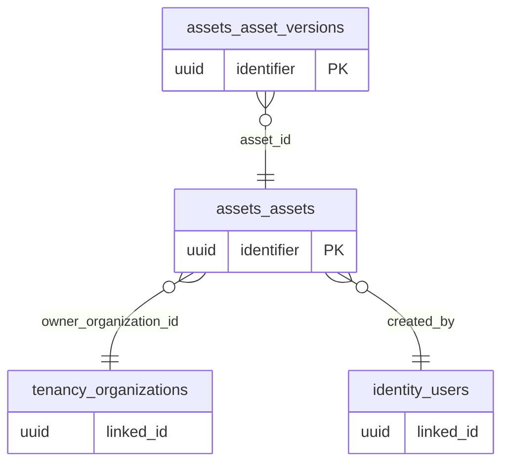

# ERD domain: assets

**2 bảng thuộc domain, 3 FK trong/phụ thuộc domain.** Bảng ngoài domain trong hình là neighbor để mô tả quan hệ, không chuyển quyền sở hữu dữ liệu.

- [`assets.assets`](tables/assets.assets.md) — Danh mục asset source; không đại diện vật phẩm đã sở hữu.
- [`assets.asset_versions`](tables/assets.asset_versions.md) — Version/hash bất biến của GLB/ảnh/video; asset đã approve không cập nhật trong chỗ.
