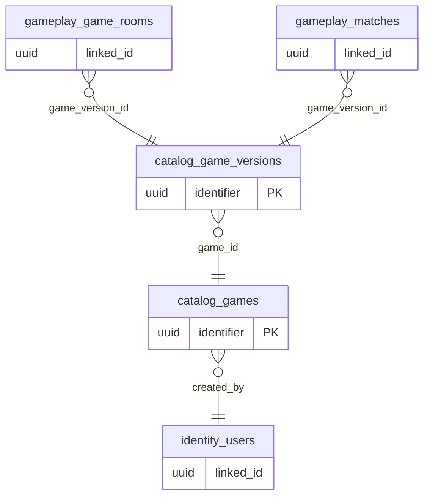

# ERD domain: catalog

**2 bảng thuộc domain, 4 FK trong/phụ thuộc domain.** Bảng ngoài domain trong hình là neighbor để mô tả quan hệ, không chuyển quyền sở hữu dữ liệu.

- [`catalog.games`](tables/catalog.games.md) — Game Registry; danh mục game độc lập room, kết quả, phần thưởng.
- [`catalog.game_versions`](tables/catalog.game_versions.md) — Phiên bản luật và manifest được pin vào phòng/trận; published không sửa.
