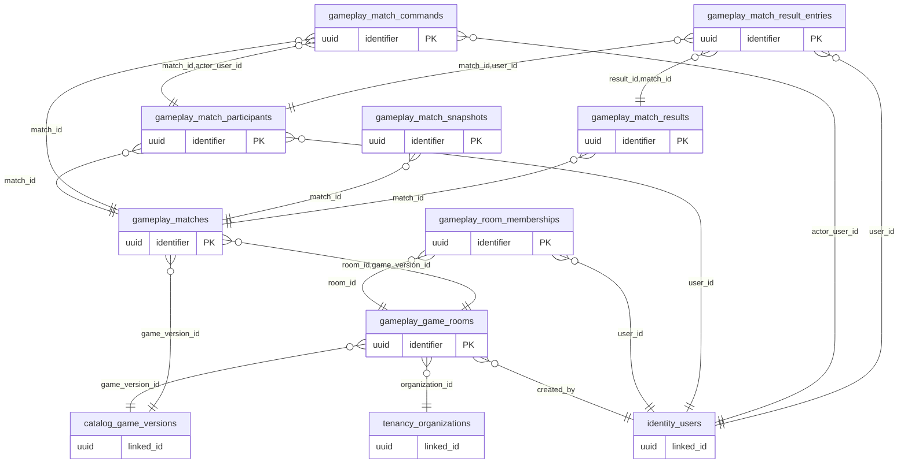

# ERD domain: gameplay

**8 bảng thuộc domain, 17 FK trong/phụ thuộc domain.** Bảng ngoài domain trong hình là neighbor để mô tả quan hệ, không chuyển quyền sở hữu dữ liệu.

- [`gameplay.game_rooms`](tables/gameplay.game_rooms.md) — Phòng chờ trước trận; một room có thể có nhiều trận rematch.
- [`gameplay.room_memberships`](tables/gameplay.room_memberships.md) — Thành viên và ghế của phòng; chỉ ghế active được unique.
- [`gameplay.matches`](tables/gameplay.matches.md) — Trận cụ thể pin game_version từ room; kết quả server xác minh.
- [`gameplay.match_participants`](tables/gameplay.match_participants.md) — Người chơi/quan sát có định danh; ghế unique khi khác null.
- [`gameplay.match_commands`](tables/gameplay.match_commands.md) — Lệnh đã được Game Server kiểm tra; append-only, idempotent.
- [`gameplay.match_snapshots`](tables/gameplay.match_snapshots.md) — Snapshot phiên bản state và hash để replay sau khi reconnect.
- [`gameplay.match_results`](tables/gameplay.match_results.md) — Kết quả một lần cho một trận; sửa sai bằng dòng bù/version tương lai.
- [`gameplay.match_result_entries`](tables/gameplay.match_result_entries.md) — Điểm/địa vị trong kết quả, không phải bảng xếp hạng hay ví Coin.
