# ERD domain: identity

**5 bảng thuộc domain, 22 FK trong/phụ thuộc domain.** Bảng ngoài domain trong hình là neighbor để mô tả quan hệ, không chuyển quyền sở hữu dữ liệu.

```mermaid
erDiagram
    identity_users {
        uuid identifier PK
    }
    identity_external_identities {
        uuid identifier PK
    }
    identity_profiles {
        uuid identifier PK
    }
    identity_guardian_links {
        uuid identifier PK
    }
    identity_policy_acknowledgments {
        uuid identifier PK
    }
    tenancy_organization_memberships {
        uuid linked_id
    }
    tenancy_role_assignments {
        uuid linked_id
    }
    assets_assets {
        uuid linked_id
    }
    catalog_games {
        uuid linked_id
    }
    gameplay_game_rooms {
        uuid linked_id
    }
    gameplay_room_memberships {
        uuid linked_id
    }
    gameplay_match_participants {
        uuid linked_id
    }
    gameplay_match_commands {
        uuid linked_id
    }
    gameplay_match_result_entries {
        uuid linked_id
    }
    publishing_content_items {
        uuid linked_id
    }
    publishing_content_revisions {
        uuid linked_id
    }
    publishing_content_publications {
        uuid linked_id
    }
    integration_audit_events {
        uuid linked_id
    }
    integration_agent_approvals {
        uuid linked_id
    }
    integration_agent_invocations {
        uuid linked_id
    }
    identity_external_identities }o--|| identity_users : "user_id"
    identity_profiles }o--|| identity_users : "user_id"
    identity_guardian_links }o--|| identity_users : "guardian_user_id"
    identity_guardian_links }o--|| identity_users : "student_user_id"
    identity_guardian_links }o--|| identity_users : "verified_by"
    identity_policy_acknowledgments }o--|| identity_users : "user_id"
    tenancy_organization_memberships }o--|| identity_users : "user_id"
    tenancy_role_assignments }o--|| identity_users : "assigned_by"
    assets_assets }o--|| identity_users : "created_by"
    catalog_games }o--|| identity_users : "created_by"
    gameplay_game_rooms }o--|| identity_users : "created_by"
    gameplay_room_memberships }o--|| identity_users : "user_id"
    gameplay_match_participants }o--|| identity_users : "user_id"
    gameplay_match_commands }o--|| identity_users : "actor_user_id"
    gameplay_match_result_entries }o--|| identity_users : "user_id"
    publishing_content_items }o--|| identity_users : "created_by"
    publishing_content_revisions }o--|| identity_users : "created_by"
    publishing_content_publications }o--|| identity_users : "approved_by"
    integration_audit_events }o--|| identity_users : "actor_user_id"
    integration_agent_approvals }o--|| identity_users : "requested_by"
    integration_agent_approvals }o--|| identity_users : "approved_by"
    integration_agent_invocations }o--|| identity_users : "initiated_by"
```

- [`identity.users`](tables/identity.users.md) — Danh tính toàn cục của người dùng; không đồng nhất với external SSO subject.
- [`identity.external_identities`](tables/identity.external_identities.md) — Ánh xạ tài khoản bên KingDragonHub/OIDC sang user UUID nội bộ; không lưu password/token.
- [`identity.profiles`](tables/identity.profiles.md) — Thông tin hiển thị với quyền riêng tư tách biệt danh tính đăng nhập.
- [`identity.guardian_links`](tables/identity.guardian_links.md) — Quan hệ người giám hộ–học sinh; xác minh trước khi có quyền xem dữ liệu.
- [`identity.policy_acknowledgments`](tables/identity.policy_acknowledgments.md) — Bản ghi phiên bản chính sách đã xác nhận; không thay thế quy trình đồng ý hợp pháp.
