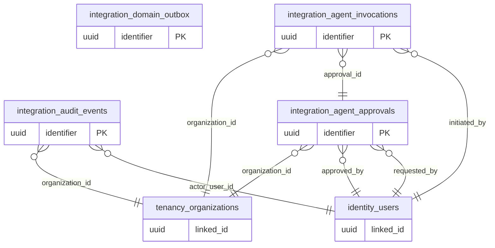

# ERD domain: integration

**4 bảng thuộc domain, 8 FK trong/phụ thuộc domain.** Bảng ngoài domain trong hình là neighbor để mô tả quan hệ, không chuyển quyền sở hữu dữ liệu.

- [`integration.domain_outbox`](tables/integration.domain_outbox.md) — Thông điệp nghiệp vụ sau commit; consumer retry idempotent.
- [`integration.audit_events`](tables/integration.audit_events.md) — Lịch sử tác động append-only và redacted; không đưa token hoặc dữ liệu trẻ em vào payload.
- [`integration.agent_approvals`](tables/integration.agent_approvals.md) — Human approval gắn với hash và phạm vi chính xác, có hạn dùng.
- [`integration.agent_invocations`](tables/integration.agent_invocations.md) — Một lần gọi typed tool và kết quả auditable; không cấp tool qua table này.
