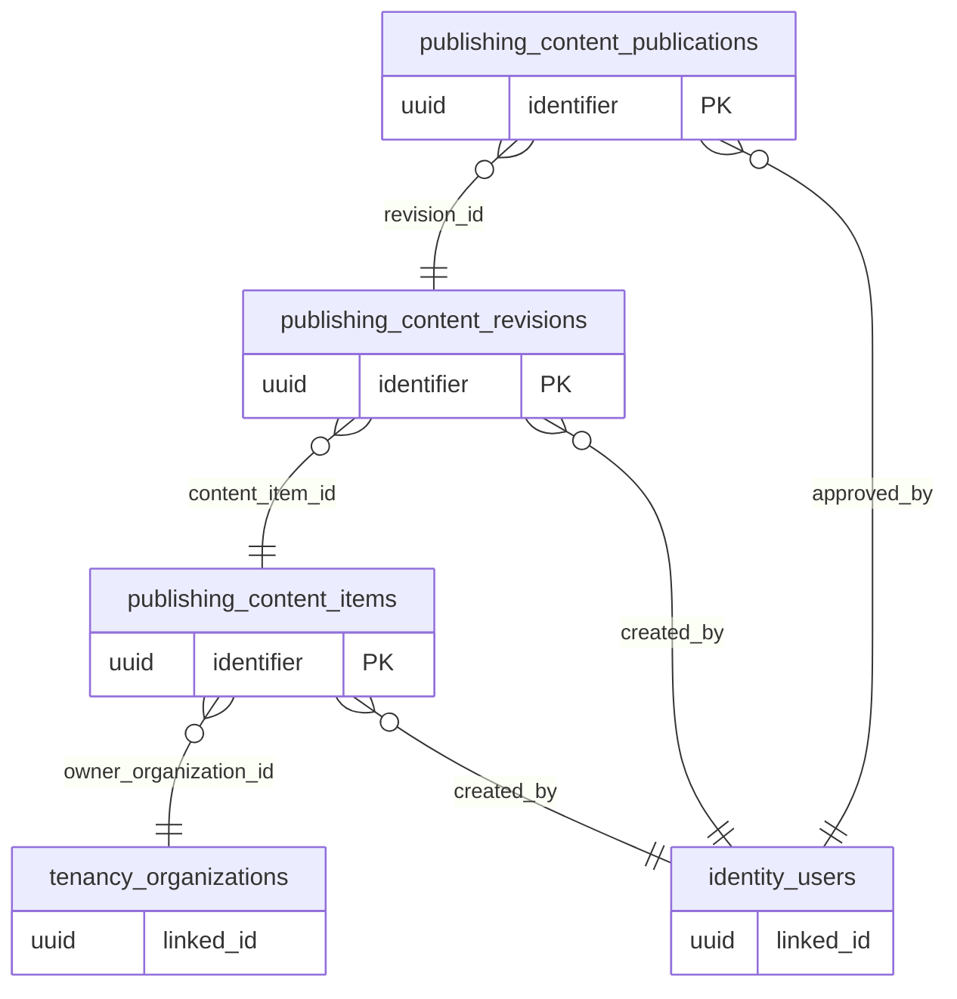

# ERD domain: publishing

**3 bảng thuộc domain, 6 FK trong/phụ thuộc domain.** Bảng ngoài domain trong hình là neighbor để mô tả quan hệ, không chuyển quyền sở hữu dữ liệu.

- [`publishing.content_items`](tables/publishing.content_items.md) — Trang/bài/khối nội dung; không trộn event/season/campaign.
- [`publishing.content_revisions`](tables/publishing.content_revisions.md) — Nội dung theo revision, hash và người tạo, không ghi đè bản cũ.
- [`publishing.content_publications`](tables/publishing.content_publications.md) — Con trỏ phát hành và cửa sổ thời gian; phải được phê duyệt đúng revision.
