# ERD domain: tenancy

**6 bảng thuộc domain, 13 FK trong/phụ thuộc domain.** Bảng ngoài domain trong hình là neighbor để mô tả quan hệ, không chuyển quyền sở hữu dữ liệu.

```mermaid
erDiagram
    tenancy_organizations {
        uuid identifier PK
    }
    tenancy_organization_memberships {
        uuid identifier PK
    }
    tenancy_roles {
        uuid identifier PK
    }
    tenancy_permissions {
        uuid identifier PK
    }
    tenancy_role_permissions {
        uuid identifier PK
    }
    tenancy_role_assignments {
        uuid identifier PK
    }
    identity_users {
        uuid linked_id
    }
    assets_assets {
        uuid linked_id
    }
    gameplay_game_rooms {
        uuid linked_id
    }
    publishing_content_items {
        uuid linked_id
    }
    integration_audit_events {
        uuid linked_id
    }
    integration_agent_approvals {
        uuid linked_id
    }
    integration_agent_invocations {
        uuid linked_id
    }
    tenancy_organization_memberships }o--|| tenancy_organizations : "organization_id"
    tenancy_organization_memberships }o--|| identity_users : "user_id"
    tenancy_role_permissions }o--|| tenancy_roles : "role_id"
    tenancy_role_permissions }o--|| tenancy_permissions : "permission_id"
    tenancy_role_assignments }o--|| tenancy_roles : "role_id"
    tenancy_role_assignments }o--|| identity_users : "assigned_by"
    tenancy_role_assignments }o--|| tenancy_organization_memberships : "organization_id,user_id"
    assets_assets }o--|| tenancy_organizations : "owner_organization_id"
    gameplay_game_rooms }o--|| tenancy_organizations : "organization_id"
    publishing_content_items }o--|| tenancy_organizations : "owner_organization_id"
    integration_audit_events }o--|| tenancy_organizations : "organization_id"
    integration_agent_approvals }o--|| tenancy_organizations : "organization_id"
    integration_agent_invocations }o--|| tenancy_organizations : "organization_id"
```

- [`tenancy.organizations`](tables/tenancy.organizations.md) — Trường, CLB hoặc đơn vị vận hành; tách khỏi người dùng toàn cục.
- [`tenancy.organization_memberships`](tables/tenancy.organization_memberships.md) — Thành viên trong tổ chức, có trạng thái riêng và FK toàn vẹn.
- [`tenancy.roles`](tables/tenancy.roles.md) — Vai trò nghiệp vụ theo code; không dùng một role global trong users.
- [`tenancy.permissions`](tables/tenancy.permissions.md) — Quyền chi tiết áp dụng bởi service, không mặc định do UI quyết định.
- [`tenancy.role_permissions`](tables/tenancy.role_permissions.md) — Quan hệ N–N giữa vai trò và quyền.
- [`tenancy.role_assignments`](tables/tenancy.role_assignments.md) — Phân vai trò theo membership trong tổ chức, không tự cấp quyền qua SSO claim.
