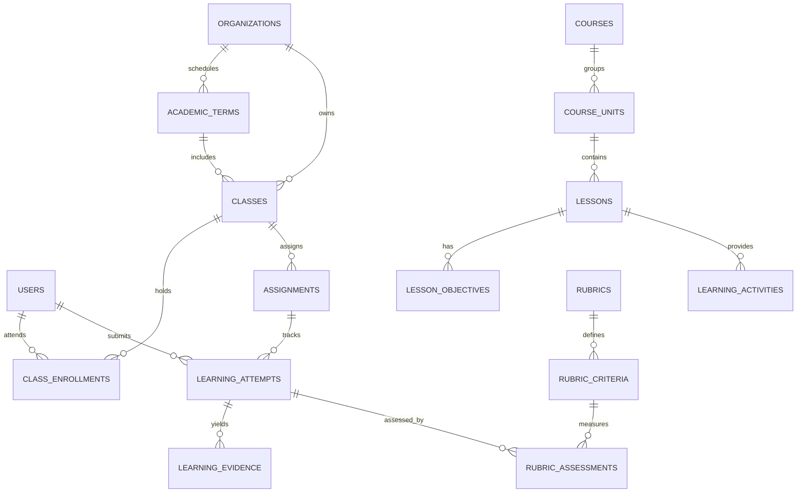
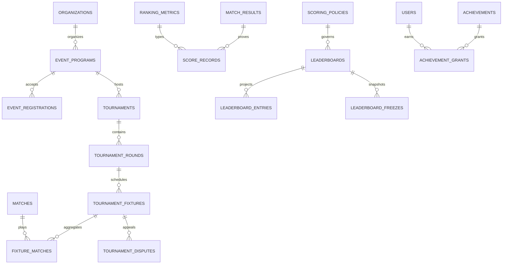
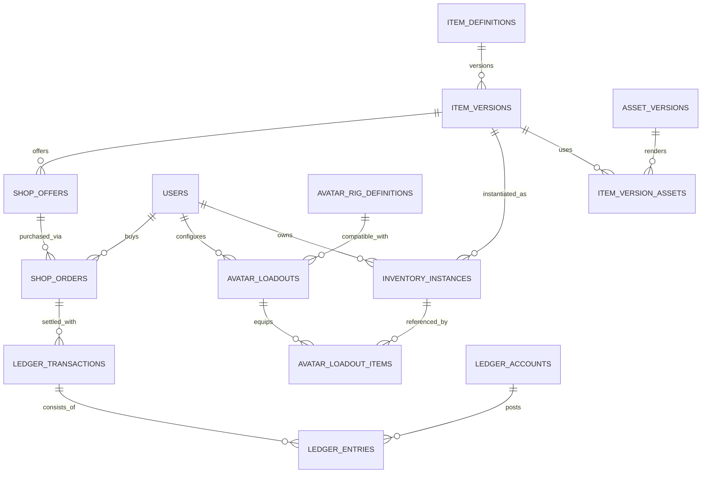
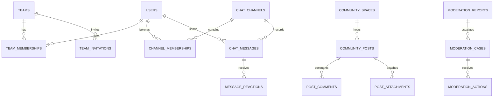
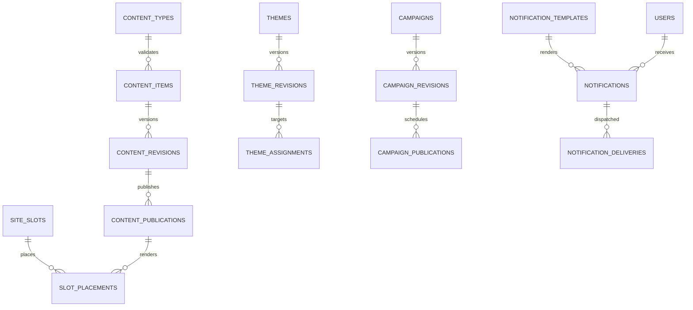
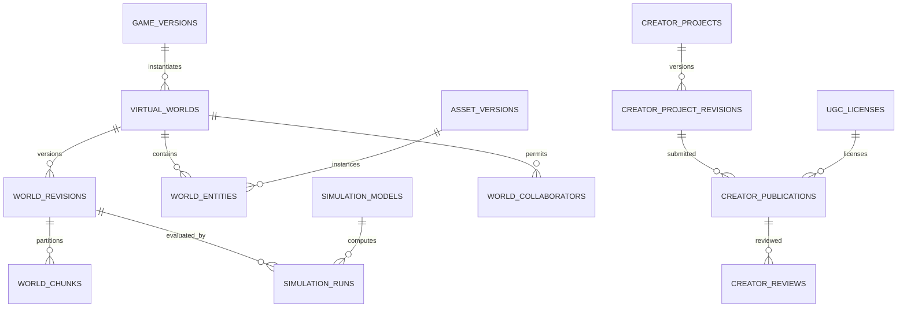
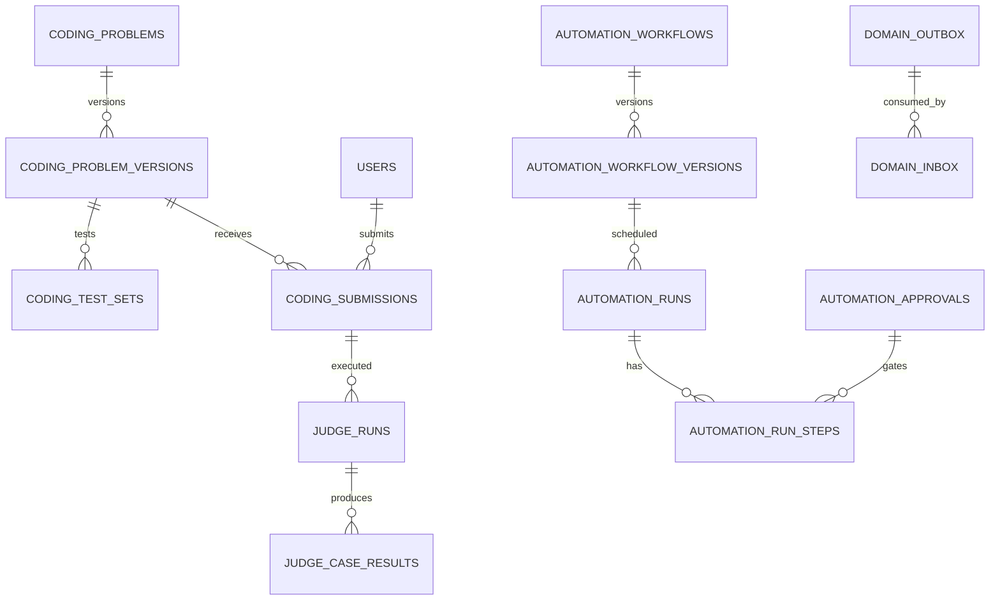

# Full-Platform Database Relationship Blueprint (beyond P0)
**Status:** PROPOSED LOGICAL MAP; **not SQL**, not physical migrations, and not a substitute for detailed per-table P1/P2 dictionary.
**Source:** `docs/architecture/DATABASE_DATA_DICTIONARY.md` (159 logical entries plus AI/MCP addendum), `docs/economy/ECONOMY_INVENTORY_DATA_MODEL.md`, `docs/architecture/DB_FREEZE_READINESS_V2.md`.
**P0 physically modeled and tested:** [30 tables + per-table ERD](README.md).

## Coverage and refinement plan
The full program includes education, social, competition, economy/avatars, 3D persistent worlds, game-creation and AI workflows. Their candidates should be documented here as explicit *future relationship proposals*, **not declared SQL FKs**. Each later migration must have its own precise one-table-one-diagram datasheet, edge cases, RLS policy, index and transactional tests similar to the 30-table P0 set.

### P1 — Education & Classroom

**Decisions needed:** class membership rollover vs history, group assignment recipients, guardian access, rubric revision pin; teacher authority must not be inferred from public profile. Any match-based learning evidence must reference verified match/version, not client claims.

### P1 — Events, Competition, Leaderboard & Honors

**Decisions needed:** rank tie break/order, audience anonymity for minors, rank vs wallet XP distinction, result correction ledger, dispute holds, Hall-of-Fame editorial approval. Entries are projections: source is append-only score records with policy version.

### P1 — Avatar, Official Shop & Economy

**Decisions needed:** item slot conflict graph (hair/face/head/hands/legs/suit/pet/profile), ownership instance vs stack, bound vs transferable, non-negative balanced currency and atomic order/stock/grant; no pay-to-win, no child peer trading. **No P0 wallet table** was added before owner signs closed-loop Coin policy.

### P1/P2 — Community and Safety

**Safety gates:** minor closed channels only, structured moderation evidence retention, no arbitrary open stranger messages. Polymorphic report target requires explicit typed target/check constraints or bridge tables, not an unvalidated generic FK.

### P1 — CMS, Themes, Notifications

**Gates:** exact approved revisions; priority resolution/timezone; no unrestricted CMS CSS/JS; audience/guardian targeting; immutable publication audit and rollback.

### P2 — Persistent 3D Worlds and Creator

**Gates:** deterministic simulation/replay, storage budgets, state schema migration, licensing/provenance and moderation of user-created games.

### P2 — Coding Judge, Agent Automation & Reliability

**Gates:** isolated judge runner, private testsets, secure immutable tool approval exact hash, idempotent durable runs. The AI/MCP addendum has separate conceptual registry; reconcile names/ownership before later schema release.

## Relationship correctness rules for future per-table ERDs
1. A Mermaid arrow is an **expected conceptual association**, not a real FK until a migration declares exact constrained columns.
2. Multiplicity in draft diagrams must be reviewed against policy; cross-tenant membership and result projection may need bridge tables.
3. Each new approved physical table must have exactly one `docs/database/tables/<schema>.<table>.md` datasheet with DDL, keys, inbound/outbound FK arrows, data classification, owner, indices, state machine and test evidence.
4. Backwards compatibility with released rooms/replays/ownership takes priority over adding speculative columns.
5. Never copy sample diagram as SQL; physical migration and SSO/privacy/retention approval are separate gates.
