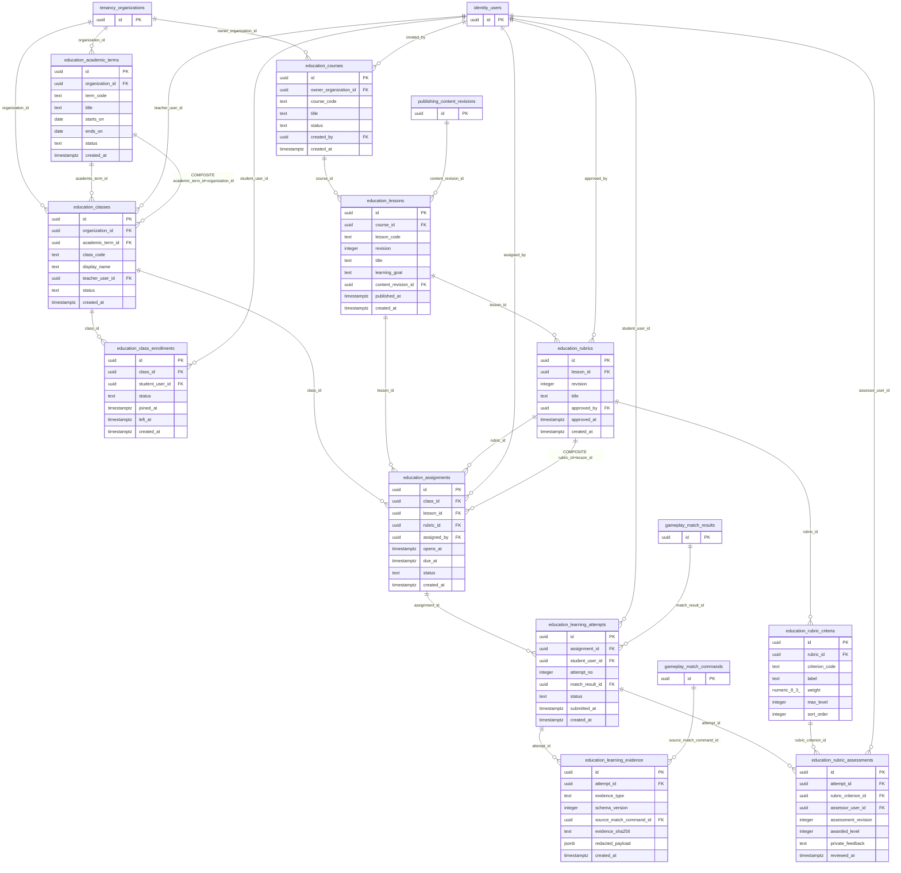

# Education P1-A — Physical PostgreSQL ERD & Exact Constraint Overlay
**Status:** DEV/CI migration candidate; **NOT frozen / NOT deployed to production**.
**SQL:** `db/migrations/0002_p1a_education_candidate.sql`. **Test:** `db/tests/0002_p1a_education_smoke.sql`. Domain candidate metadata: `db/schema/p1_candidate_tables.json`.

This diagram shows all 11 Education tables, direct P0 foreign-key dependencies, **two additional composite FK gates** included in the physical migration, and column/type declarations. The 44-tab [P1 design Draw.io](diagrams/Board_Game_Universe_P1_Editable.drawio) is still a *candidate diagram*; it does not automatically represent additional physical constraints. Do not treat its older lines as a complete DDL snapshot.

## Physical constraints added beyond the baseline candidate model
| Database table | Physical invariant | Enforcement and reason |
|---|---|---|
| `education.academic_terms` | `UNIQUE(id,organization_id)` | Enables consistent organization-scoped term reference |
| `education.classes` | `FOREIGN KEY (academic_term_id,organization_id)` → `education.academic_terms(id,organization_id)` | Blocks cross-org class/term mismatch even when both exist |
| `education.rubrics` | `UNIQUE(id,lesson_id)` | Enables assignment rubric to be tied to exact lesson version |
| `education.assignments` | `FOREIGN KEY (rubric_id,lesson_id)` → `education.rubrics(id,lesson_id)` | Blocks rubric from a different lesson |
| `education.learning_attempts` | `edu_attempt_scope` trigger | Requires active class enrollment and verified participant when attaching match result |
| `education.rubric_assessments` | `edu_grade_consistency` trigger | Enforces criterion belongs to assignment rubric and grade <= criterion max |
| `education.learning_evidence` and `rubric_assessments` | Append-only triggers | Historical evidence/grade corrections by new records, not overwriting |
| `education.lessons` / `rubrics` / `rubric_criteria` | Immutable when published/approved | Prevents retroactive changes to assessment authority |
| All 11 tables | `ENABLE ROW LEVEL SECURITY` + `FORCE ROW LEVEL SECURITY`, no policies | Default deny, pending SSO and guardian authorization |

## Explicit cross-layer limitations
- No exact KingDragonHub authenticated teacher principal or guardian consent service yet.
- Triggers validate referential / selected domain integrity, **not** teacher authority or PII retention.
- The migration does **not** grant SELECT/INSERT/UPDATE/DELETE to any runtime role, and creates **zero RLS allow policies**.
- P0 schema is required. No existing data backfill or production migration safety has been tested.
- UI must display no live grade/classroom functionality until authenticated Backend/domain policies and staging security tests are available.
