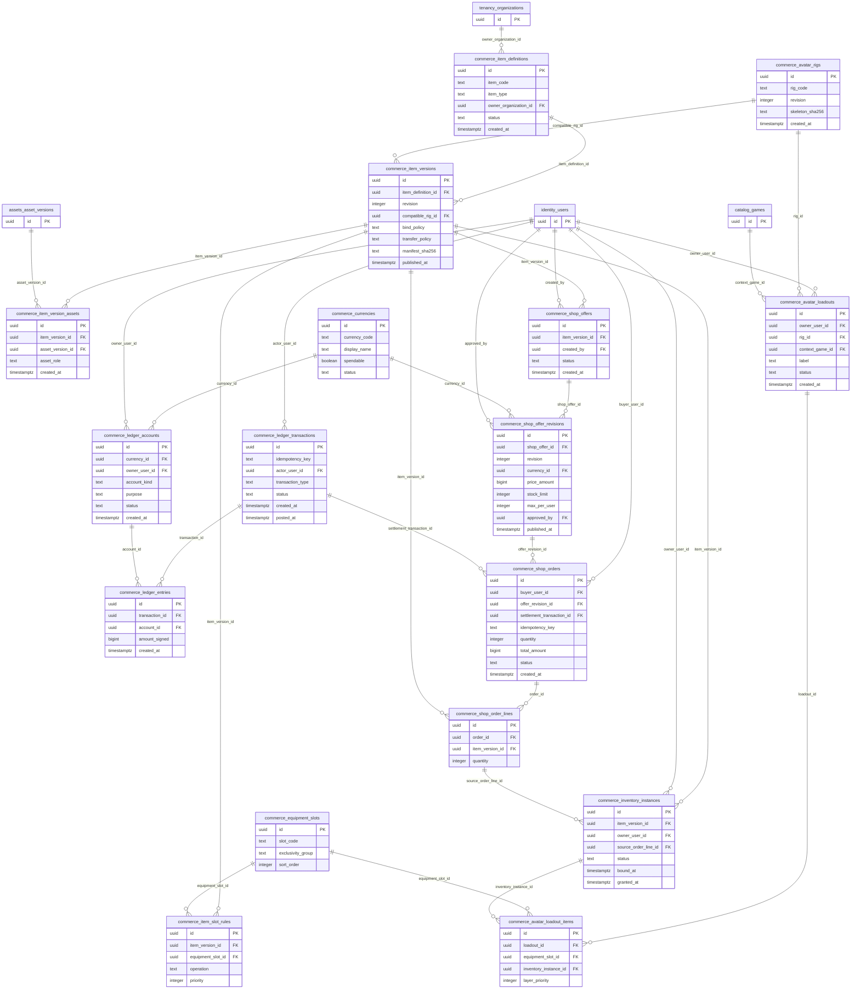

# P1 COMMERCE — Domain ERD · DESIGN PROPOSAL

17 proposed tables, 31 relations touching this domain. Other nodes included as P0/P1 dependencies.

- [commerce.avatar_rigs](tables/commerce.avatar_rigs.md) — Định nghĩa rig tương thích, phiên bản bất biến và GLB source.
- [commerce.item_definitions](tables/commerce.item_definitions.md) — Định danh loại vật phẩm, không phải quyền sở hữu.
- [commerce.item_versions](tables/commerce.item_versions.md) — Bản phát hành cosmetic/version/rig and binding policy.
- [commerce.item_version_assets](tables/commerce.item_version_assets.md) — N–N vật phẩm ↔ bản asset đã được duyệt.
- [commerce.equipment_slots](tables/commerce.equipment_slots.md) — Danh mục vị trí trang bị; không hardcode thành từng cột User.
- [commerce.item_slot_rules](tables/commerce.item_slot_rules.md) — Vị trí chiếm dụng/xung đột của vật phẩm theo revision.
- [commerce.inventory_instances](tables/commerce.inventory_instances.md) — Bản quyền sở hữu cá thể duy nhất, độc lập item definition/version.
- [commerce.avatar_loadouts](tables/commerce.avatar_loadouts.md) — Preset avatar/rig theo ngữ cảnh, không đổi collision trong game.
- [commerce.avatar_loadout_items](tables/commerce.avatar_loadout_items.md) — Vật phẩm đang trang bị; phải xác minh ownership và rig/slot.
- [commerce.currencies](tables/commerce.currencies.md) — Đơn vị tiền ảo earned Coin/Event Token; không có thanh toán tiền thật.
- [commerce.ledger_accounts](tables/commerce.ledger_accounts.md) — Tài khoản ledger theo currency và chủ thể, tách user/system.
- [commerce.ledger_transactions](tables/commerce.ledger_transactions.md) — Header immutable/idempotent giao dịch cân bằng; posted chỉ khi đủ entries.
- [commerce.ledger_entries](tables/commerce.ledger_entries.md) — Double-entry signed amount; tổng 0 theo transaction/currency phải kiểm tra atomically.
- [commerce.shop_offers](tables/commerce.shop_offers.md) — Đề nghị bán chính thức, không phải marketplace ngang hàng.
- [commerce.shop_offer_revisions](tables/commerce.shop_offer_revisions.md) — Bản giá/số lượng/kho hàng/version; không đổi giá đã dùng trong đơn.
- [commerce.shop_orders](tables/commerce.shop_orders.md) — Đơn mua với idempotency key, buyer, phiên bản giá và ledger settlement.
- [commerce.shop_order_lines](tables/commerce.shop_order_lines.md) — Receipt link item version và số lượng được giao; instance có thể tham chiếu dòng đơn.
