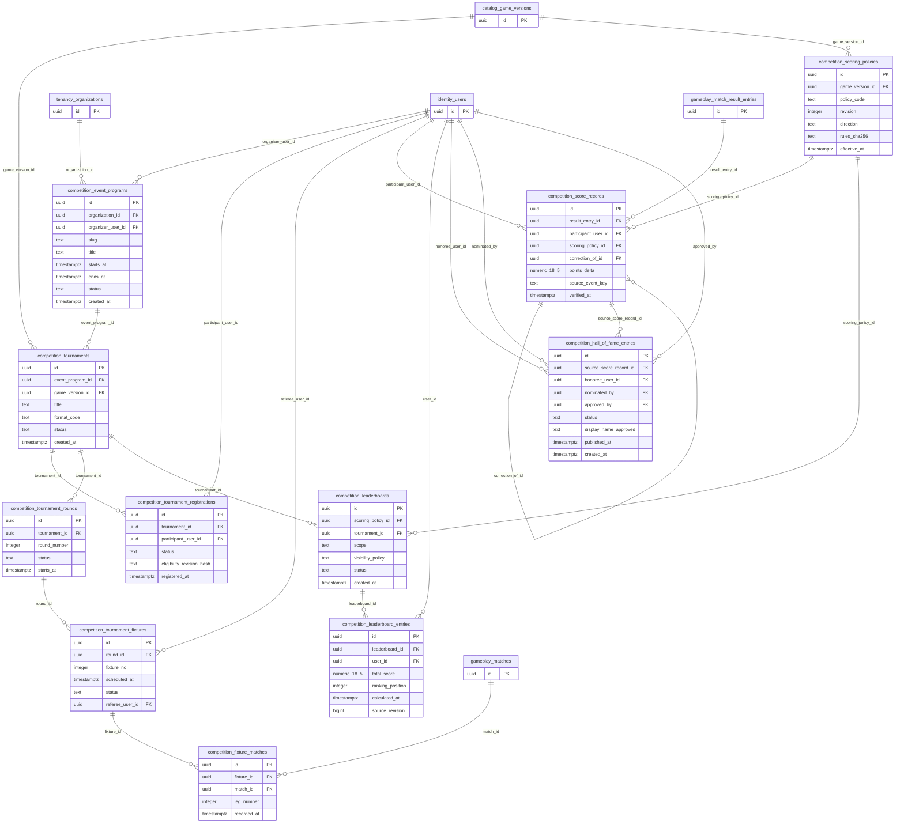

# P1 COMPETITION — Domain ERD · DESIGN PROPOSAL

11 proposed tables, 24 relations touching this domain. Other nodes included as P0/P1 dependencies.

- [competition.event_programs](tables/competition.event_programs.md) — Sự kiện do tổ chức tổ chức; không đồng nhất CMS campaign.
- [competition.tournaments](tables/competition.tournaments.md) — Giải đấu của event gắn game version và thể thức đã phê duyệt.
- [competition.tournament_registrations](tables/competition.tournament_registrations.md) — Đăng ký cá nhân; eligibility/consent kiểm tra bởi service.
- [competition.tournament_rounds](tables/competition.tournament_rounds.md) — Vòng đấu thuộc giải, không trực tiếp đồng nhất với một trận.
- [competition.tournament_fixtures](tables/competition.tournament_fixtures.md) — Cặp đấu theo vòng, có thể liên kết nhiều match rematch.
- [competition.fixture_matches](tables/competition.fixture_matches.md) — Bảng cầu nối fixture → match đã xác minh từ Game Server.
- [competition.scoring_policies](tables/competition.scoring_policies.md) — Phiên bản chính sách tính điểm, normalize/tie break theo game.
- [competition.score_records](tables/competition.score_records.md) — Ledger điểm immutable chứng minh từ entry kết quả authoritative, sửa sai bằng bù.
- [competition.leaderboards](tables/competition.leaderboards.md) — Định nghĩa bảng xếp hạng, không chứa đánh giá học thuật cá nhân công khai.
- [competition.leaderboard_entries](tables/competition.leaderboard_entries.md) — Projection tổng điểm/rank có thể tính lại từ score_records.
- [competition.hall_of_fame_entries](tables/competition.hall_of_fame_entries.md) — Vinh danh được phê duyệt riêng, có quyền rút công bố.
