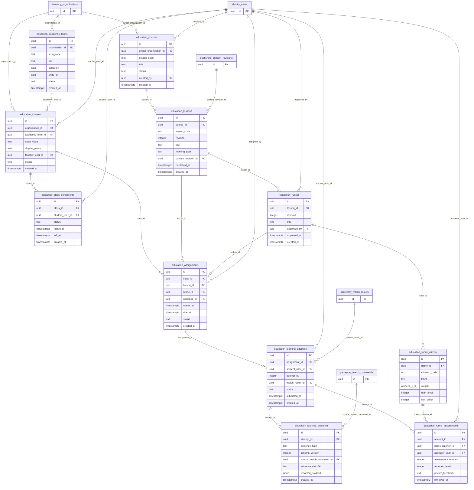

# P1 EDUCATION — Domain ERD · DESIGN PROPOSAL

11 proposed tables, 25 relations touching this domain. Other nodes included as P0/P1 dependencies.

- [education.academic_terms](tables/education.academic_terms.md) — Niên khóa theo tổ chức, ngày bắt đầu/kết thúc theo UTC.
- [education.classes](tables/education.classes.md) — Lớp học thuộc tổ chức và niên khóa; phân quyền theo membership tổ chức.
- [education.class_enrollments](tables/education.class_enrollments.md) — Lịch sử tham gia lớp học; không suy quyền từ việc tồn tại dòng dữ liệu.
- [education.courses](tables/education.courses.md) — Khóa/chương trình học dùng lại qua nhiều lớp; có thể do tổ chức sở hữu.
- [education.lessons](tables/education.lessons.md) — Bài học phiên bản hóa nội dung để giữ bằng chứng lịch sử.
- [education.rubrics](tables/education.rubrics.md) — Bộ tiêu chí đánh giá có revision, liên kết chính xác bài học.
- [education.rubric_criteria](tables/education.rubric_criteria.md) — Tiêu chí rubric riêng biệt; mức đánh giá cần diễn giải rõ.
- [education.assignments](tables/education.assignments.md) — Giáo viên giao bài cho lớp; ràng buộc lesson/rubric revision.
- [education.learning_attempts](tables/education.learning_attempts.md) — Lượt nộp bài cá nhân; kết quả game chỉ là bằng chứng, không phải điểm học thuật.
- [education.learning_evidence](tables/education.learning_evidence.md) — Minh chứng theo lượt và schema version, mặc định riêng tư.
- [education.rubric_assessments](tables/education.rubric_assessments.md) — Kết quả giáo viên nhận xét tiêu chí theo revision; lịch sử không ghi đè.
