# P1 — Overall ERD (DRAFT, not migrated)

39 P1 proposed entities, 80 FK candidates. Cross-refs to P0 drawn as external context nodes.

```mermaid
erDiagram
    education_academic_terms {
        uuid id PK
        uuid organization_id FK
        text term_code 
        text title 
        date starts_on 
        date ends_on 
        text status 
        timestamptz created_at 
    }
    education_classes {
        uuid id PK
        uuid organization_id FK
        uuid academic_term_id FK
        text class_code 
        text display_name 
        uuid teacher_user_id FK
        text status 
        timestamptz created_at 
    }
    education_class_enrollments {
        uuid id PK
        uuid class_id FK
        uuid student_user_id FK
        text status 
        timestamptz joined_at 
        timestamptz left_at 
        timestamptz created_at 
    }
    education_courses {
        uuid id PK
        uuid owner_organization_id FK
        text course_code 
        text title 
        text status 
        uuid created_by FK
        timestamptz created_at 
    }
    education_lessons {
        uuid id PK
        uuid course_id FK
        text lesson_code 
        integer revision 
        text title 
        text learning_goal 
        uuid content_revision_id FK
        timestamptz published_at 
        timestamptz created_at 
    }
    education_rubrics {
        uuid id PK
        uuid lesson_id FK
        integer revision 
        text title 
        uuid approved_by FK
        timestamptz approved_at 
        timestamptz created_at 
    }
    education_rubric_criteria {
        uuid id PK
        uuid rubric_id FK
        text criterion_code 
        text label 
        numeric_8_3_ weight 
        integer max_level 
        integer sort_order 
    }
    education_assignments {
        uuid id PK
        uuid class_id FK
        uuid lesson_id FK
        uuid rubric_id FK
        uuid assigned_by FK
        timestamptz opens_at 
        timestamptz due_at 
        text status 
        timestamptz created_at 
    }
    education_learning_attempts {
        uuid id PK
        uuid assignment_id FK
        uuid student_user_id FK
        integer attempt_no 
        uuid match_result_id FK
        text status 
        timestamptz submitted_at 
        timestamptz created_at 
    }
    education_learning_evidence {
        uuid id PK
        uuid attempt_id FK
        text evidence_type 
        integer schema_version 
        uuid source_match_command_id FK
        text evidence_sha256 
        jsonb redacted_payload 
        timestamptz created_at 
    }
    education_rubric_assessments {
        uuid id PK
        uuid attempt_id FK
        uuid rubric_criterion_id FK
        uuid assessor_user_id FK
        integer assessment_revision 
        integer awarded_level 
        text private_feedback 
        timestamptz reviewed_at 
    }
    competition_event_programs {
        uuid id PK
        uuid organization_id FK
        uuid organizer_user_id FK
        text slug 
        text title 
        timestamptz starts_at 
        timestamptz ends_at 
        text status 
        timestamptz created_at 
    }
    competition_tournaments {
        uuid id PK
        uuid event_program_id FK
        uuid game_version_id FK
        text title 
        text format_code 
        text status 
        timestamptz created_at 
    }
    competition_tournament_registrations {
        uuid id PK
        uuid tournament_id FK
        uuid participant_user_id FK
        text status 
        text eligibility_revision_hash 
        timestamptz registered_at 
    }
    competition_tournament_rounds {
        uuid id PK
        uuid tournament_id FK
        integer round_number 
        text status 
        timestamptz starts_at 
    }
    competition_tournament_fixtures {
        uuid id PK
        uuid round_id FK
        integer fixture_no 
        timestamptz scheduled_at 
        text status 
        uuid referee_user_id FK
    }
    competition_fixture_matches {
        uuid id PK
        uuid fixture_id FK
        uuid match_id FK
        integer leg_number 
        timestamptz recorded_at 
    }
    competition_scoring_policies {
        uuid id PK
        uuid game_version_id FK
        text policy_code 
        integer revision 
        text direction 
        text rules_sha256 
        timestamptz effective_at 
    }
    competition_score_records {
        uuid id PK
        uuid result_entry_id FK
        uuid participant_user_id FK
        uuid scoring_policy_id FK
        uuid correction_of_id FK
        numeric_18_5_ points_delta 
        text source_event_key 
        timestamptz verified_at 
    }
    competition_leaderboards {
        uuid id PK
        uuid scoring_policy_id FK
        uuid tournament_id FK
        text scope 
        text visibility_policy 
        text status 
        timestamptz created_at 
    }
    competition_leaderboard_entries {
        uuid id PK
        uuid leaderboard_id FK
        uuid user_id FK
        numeric_18_5_ total_score 
        integer ranking_position 
        timestamptz calculated_at 
        bigint source_revision 
    }
    competition_hall_of_fame_entries {
        uuid id PK
        uuid source_score_record_id FK
        uuid honoree_user_id FK
        uuid nominated_by FK
        uuid approved_by FK
        text status 
        text display_name_approved 
        timestamptz published_at 
        timestamptz created_at 
    }
    commerce_avatar_rigs {
        uuid id PK
        text rig_code 
        integer revision 
        text skeleton_sha256 
        timestamptz created_at 
    }
    commerce_item_definitions {
        uuid id PK
        text item_code 
        text item_type 
        uuid owner_organization_id FK
        text status 
        timestamptz created_at 
    }
    commerce_item_versions {
        uuid id PK
        uuid item_definition_id FK
        integer revision 
        uuid compatible_rig_id FK
        text bind_policy 
        text transfer_policy 
        text manifest_sha256 
        timestamptz published_at 
    }
    commerce_item_version_assets {
        uuid id PK
        uuid item_version_id FK
        uuid asset_version_id FK
        text asset_role 
        timestamptz created_at 
    }
    commerce_equipment_slots {
        uuid id PK
        text slot_code 
        text exclusivity_group 
        integer sort_order 
    }
    commerce_item_slot_rules {
        uuid id PK
        uuid item_version_id FK
        uuid equipment_slot_id FK
        text operation 
        integer priority 
    }
    commerce_inventory_instances {
        uuid id PK
        uuid item_version_id FK
        uuid owner_user_id FK
        uuid source_order_line_id FK
        text status 
        timestamptz bound_at 
        timestamptz granted_at 
    }
    commerce_avatar_loadouts {
        uuid id PK
        uuid owner_user_id FK
        uuid rig_id FK
        uuid context_game_id FK
        text label 
        text status 
        timestamptz created_at 
    }
    commerce_avatar_loadout_items {
        uuid id PK
        uuid loadout_id FK
        uuid equipment_slot_id FK
        uuid inventory_instance_id FK
        integer layer_priority 
    }
    commerce_currencies {
        uuid id PK
        text currency_code 
        text display_name 
        boolean spendable 
        text status 
    }
    commerce_ledger_accounts {
        uuid id PK
        uuid currency_id FK
        uuid owner_user_id FK
        text account_kind 
        text purpose 
        text status 
        timestamptz created_at 
    }
    commerce_ledger_transactions {
        uuid id PK
        text idempotency_key 
        uuid actor_user_id FK
        text transaction_type 
        text status 
        timestamptz created_at 
        timestamptz posted_at 
    }
    commerce_ledger_entries {
        uuid id PK
        uuid transaction_id FK
        uuid account_id FK
        bigint amount_signed 
        timestamptz created_at 
    }
    commerce_shop_offers {
        uuid id PK
        uuid item_version_id FK
        uuid created_by FK
        text status 
        timestamptz created_at 
    }
    commerce_shop_offer_revisions {
        uuid id PK
        uuid shop_offer_id FK
        integer revision 
        uuid currency_id FK
        bigint price_amount 
        integer stock_limit 
        integer max_per_user 
        uuid approved_by FK
        timestamptz published_at 
    }
    commerce_shop_orders {
        uuid id PK
        uuid buyer_user_id FK
        uuid offer_revision_id FK
        uuid settlement_transaction_id FK
        text idempotency_key 
        integer quantity 
        bigint total_amount 
        text status 
        timestamptz created_at 
    }
    commerce_shop_order_lines {
        uuid id PK
        uuid order_id FK
        uuid item_version_id FK
        integer quantity 
    }
    tenancy_organizations {
        uuid id PK
    }
    identity_users {
        uuid id PK
    }
    publishing_content_revisions {
        uuid id PK
    }
    gameplay_match_results {
        uuid id PK
    }
    gameplay_match_commands {
        uuid id PK
    }
    catalog_game_versions {
        uuid id PK
    }
    gameplay_matches {
        uuid id PK
    }
    gameplay_match_result_entries {
        uuid id PK
    }
    assets_asset_versions {
        uuid id PK
    }
    catalog_games {
        uuid id PK
    }
    tenancy_organizations ||--o{ education_academic_terms : "organization_id"
    tenancy_organizations ||--o{ education_classes : "organization_id"
    education_academic_terms ||--o{ education_classes : "academic_term_id"
    identity_users ||--o{ education_classes : "teacher_user_id"
    education_classes ||--o{ education_class_enrollments : "class_id"
    identity_users ||--o{ education_class_enrollments : "student_user_id"
    tenancy_organizations ||--o{ education_courses : "owner_organization_id"
    identity_users ||--o{ education_courses : "created_by"
    education_courses ||--o{ education_lessons : "course_id"
    publishing_content_revisions ||--o{ education_lessons : "content_revision_id"
    education_lessons ||--o{ education_rubrics : "lesson_id"
    identity_users ||--o{ education_rubrics : "approved_by"
    education_rubrics ||--o{ education_rubric_criteria : "rubric_id"
    education_classes ||--o{ education_assignments : "class_id"
    education_lessons ||--o{ education_assignments : "lesson_id"
    education_rubrics ||--o{ education_assignments : "rubric_id"
    identity_users ||--o{ education_assignments : "assigned_by"
    education_assignments ||--o{ education_learning_attempts : "assignment_id"
    identity_users ||--o{ education_learning_attempts : "student_user_id"
    gameplay_match_results ||--o{ education_learning_attempts : "match_result_id"
    education_learning_attempts ||--o{ education_learning_evidence : "attempt_id"
    gameplay_match_commands ||--o{ education_learning_evidence : "source_match_command_id"
    education_learning_attempts ||--o{ education_rubric_assessments : "attempt_id"
    education_rubric_criteria ||--o{ education_rubric_assessments : "rubric_criterion_id"
    identity_users ||--o{ education_rubric_assessments : "assessor_user_id"
    tenancy_organizations ||--o{ competition_event_programs : "organization_id"
    identity_users ||--o{ competition_event_programs : "organizer_user_id"
    competition_event_programs ||--o{ competition_tournaments : "event_program_id"
    catalog_game_versions ||--o{ competition_tournaments : "game_version_id"
    competition_tournaments ||--o{ competition_tournament_registrations : "tournament_id"
    identity_users ||--o{ competition_tournament_registrations : "participant_user_id"
    competition_tournaments ||--o{ competition_tournament_rounds : "tournament_id"
    competition_tournament_rounds ||--o{ competition_tournament_fixtures : "round_id"
    identity_users ||--o{ competition_tournament_fixtures : "referee_user_id"
    competition_tournament_fixtures ||--o{ competition_fixture_matches : "fixture_id"
    gameplay_matches ||--o{ competition_fixture_matches : "match_id"
    catalog_game_versions ||--o{ competition_scoring_policies : "game_version_id"
    gameplay_match_result_entries ||--o{ competition_score_records : "result_entry_id"
    identity_users ||--o{ competition_score_records : "participant_user_id"
    competition_scoring_policies ||--o{ competition_score_records : "scoring_policy_id"
    competition_score_records ||--o{ competition_score_records : "correction_of_id"
    competition_scoring_policies ||--o{ competition_leaderboards : "scoring_policy_id"
    competition_tournaments ||--o{ competition_leaderboards : "tournament_id"
    competition_leaderboards ||--o{ competition_leaderboard_entries : "leaderboard_id"
    identity_users ||--o{ competition_leaderboard_entries : "user_id"
    competition_score_records ||--o{ competition_hall_of_fame_entries : "source_score_record_id"
    identity_users ||--o{ competition_hall_of_fame_entries : "honoree_user_id"
    identity_users ||--o{ competition_hall_of_fame_entries : "nominated_by"
    identity_users ||--o{ competition_hall_of_fame_entries : "approved_by"
    tenancy_organizations ||--o{ commerce_item_definitions : "owner_organization_id"
    commerce_item_definitions ||--o{ commerce_item_versions : "item_definition_id"
    commerce_avatar_rigs ||--o{ commerce_item_versions : "compatible_rig_id"
    commerce_item_versions ||--o{ commerce_item_version_assets : "item_version_id"
    assets_asset_versions ||--o{ commerce_item_version_assets : "asset_version_id"
    commerce_item_versions ||--o{ commerce_item_slot_rules : "item_version_id"
    commerce_equipment_slots ||--o{ commerce_item_slot_rules : "equipment_slot_id"
    commerce_item_versions ||--o{ commerce_inventory_instances : "item_version_id"
    identity_users ||--o{ commerce_inventory_instances : "owner_user_id"
    commerce_shop_order_lines ||--o{ commerce_inventory_instances : "source_order_line_id"
    identity_users ||--o{ commerce_avatar_loadouts : "owner_user_id"
    commerce_avatar_rigs ||--o{ commerce_avatar_loadouts : "rig_id"
    catalog_games ||--o{ commerce_avatar_loadouts : "context_game_id"
    commerce_avatar_loadouts ||--o{ commerce_avatar_loadout_items : "loadout_id"
    commerce_equipment_slots ||--o{ commerce_avatar_loadout_items : "equipment_slot_id"
    commerce_inventory_instances ||--o{ commerce_avatar_loadout_items : "inventory_instance_id"
    commerce_currencies ||--o{ commerce_ledger_accounts : "currency_id"
    identity_users ||--o{ commerce_ledger_accounts : "owner_user_id"
    identity_users ||--o{ commerce_ledger_transactions : "actor_user_id"
    commerce_ledger_transactions ||--o{ commerce_ledger_entries : "transaction_id"
    commerce_ledger_accounts ||--o{ commerce_ledger_entries : "account_id"
    commerce_item_versions ||--o{ commerce_shop_offers : "item_version_id"
    identity_users ||--o{ commerce_shop_offers : "created_by"
    commerce_shop_offers ||--o{ commerce_shop_offer_revisions : "shop_offer_id"
    commerce_currencies ||--o{ commerce_shop_offer_revisions : "currency_id"
    identity_users ||--o{ commerce_shop_offer_revisions : "approved_by"
    identity_users ||--o{ commerce_shop_orders : "buyer_user_id"
    commerce_shop_offer_revisions ||--o{ commerce_shop_orders : "offer_revision_id"
    commerce_ledger_transactions ||--o{ commerce_shop_orders : "settlement_transaction_id"
    commerce_shop_orders ||--o{ commerce_shop_order_lines : "order_id"
    commerce_item_versions ||--o{ commerce_shop_order_lines : "item_version_id"
```

**Editable full source:** [Draw.io](diagrams/Board_Game_Universe_P1_Editable.drawio). Canonical proposals: `db/schema/p1_candidate_tables.json`.
