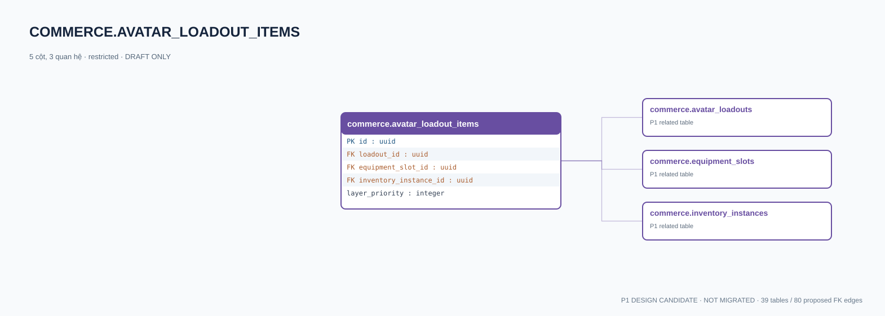

# commerce.avatar_loadout_items — P1 DATA DICTIONARY

**Status:** DRAFT / NOT MIGRATED · **Owner:** commerce · **Data classification:** restricted

Vật phẩm đang trang bị; phải xác minh ownership và rig/slot.

## Direct relationship preview

## Columns (5)
| Column | Candidate PostgreSQL type | Key | Nullable | Default |
|---|---|---|---|---|
| `id` | `uuid` | PK | NO | — |
| `loadout_id` | `uuid` | FK → [commerce.avatar_loadouts](commerce.avatar_loadouts.md).`id` | NO | — |
| `equipment_slot_id` | `uuid` | FK → [commerce.equipment_slots](commerce.equipment_slots.md).`id` | NO | — |
| `inventory_instance_id` | `uuid` | FK → [commerce.inventory_instances](commerce.inventory_instances.md).`id` | NO | — |
| `layer_priority` | `integer` | — | NO | — |

## Outbound foreign keys (3)
- `loadout_id` → [commerce.avatar_loadouts](commerce.avatar_loadouts.md).`id` (P1)
- `equipment_slot_id` → [commerce.equipment_slots](commerce.equipment_slots.md).`id` (P1)
- `inventory_instance_id` → [commerce.inventory_instances](commerce.inventory_instances.md).`id` (P1)

## Inbound foreign keys (0)
- None

## Proposed integrity
**Unique constraints:** `(loadout_id,equipment_slot_id)`

**Check/invariant and domain guard:**
- same inventory instance cannot occupy incompatible slots
- server verifies instance owner = loadout owner

**Indexes:** `(inventory_instance_id)`

## Required implementation and review
- Evaluate tenant/organization scope and child PII, no direct browser/MCP SQL.
- Verify FK, composite tenant conditions, status machine, optimistic revision, immutable business history, RLS allow-policy **after** SSO source audit.
- Test authorized and unauthorized roles, concurrency and referential integrity in disposable PostgreSQL **only after migration PR exists**.
- Cross-check UI screen IDs/typed API contracts; log P0/P1 decision conflicts before freezing.
