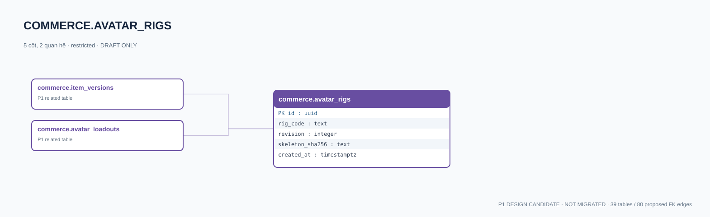

# commerce.avatar_rigs — P1 DATA DICTIONARY

**Status:** DRAFT / NOT MIGRATED · **Owner:** commerce · **Data classification:** restricted

Định nghĩa rig tương thích, phiên bản bất biến và GLB source.

## Direct relationship preview

## Columns (5)
| Column | Candidate PostgreSQL type | Key | Nullable | Default |
|---|---|---|---|---|
| `id` | `uuid` | PK | NO | — |
| `rig_code` | `text` | — | NO | — |
| `revision` | `integer` | — | NO | — |
| `skeleton_sha256` | `text` | — | NO | — |
| `created_at` | `timestamptz` | — | NO | `now()` |

## Outbound foreign keys (0)
- None

## Inbound foreign keys (2)
- [commerce.item_versions](commerce.item_versions.md).`compatible_rig_id` → `id`
- [commerce.avatar_loadouts](commerce.avatar_loadouts.md).`rig_id` → `id`

## Proposed integrity
**Unique constraints:** `(rig_code,revision)`

**Check/invariant and domain guard:**
- revision > 0
- published rig frozen

**Indexes:** `(rig_code,revision DESC)`

## Required implementation and review
- Evaluate tenant/organization scope and child PII, no direct browser/MCP SQL.
- Verify FK, composite tenant conditions, status machine, optimistic revision, immutable business history, RLS allow-policy **after** SSO source audit.
- Test authorized and unauthorized roles, concurrency and referential integrity in disposable PostgreSQL **only after migration PR exists**.
- Cross-check UI screen IDs/typed API contracts; log P0/P1 decision conflicts before freezing.
