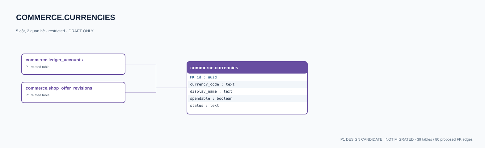

# commerce.currencies — P1 DATA DICTIONARY

**Status:** DRAFT / NOT MIGRATED · **Owner:** commerce · **Data classification:** restricted

Đơn vị tiền ảo earned Coin/Event Token; không có thanh toán tiền thật.

## Direct relationship preview

## Columns (5)
| Column | Candidate PostgreSQL type | Key | Nullable | Default |
|---|---|---|---|---|
| `id` | `uuid` | PK | NO | — |
| `currency_code` | `text` | — | NO | — |
| `display_name` | `text` | — | NO | — |
| `spendable` | `boolean` | — | NO | `true` |
| `status` | `text` | — | NO | `draft` |

## Outbound foreign keys (0)
- None

## Inbound foreign keys (2)
- [commerce.ledger_accounts](commerce.ledger_accounts.md).`currency_id` → `id`
- [commerce.shop_offer_revisions](commerce.shop_offer_revisions.md).`currency_id` → `id`

## Proposed integrity
**Unique constraints:** No additional scoped UNIQUE specified yet.

**Check/invariant and domain guard:**
- no cashout, no NFT, no lootbox in MVP

**Indexes:** Review EXPLAIN workloads before physical index choice.

## Required implementation and review
- Evaluate tenant/organization scope and child PII, no direct browser/MCP SQL.
- Verify FK, composite tenant conditions, status machine, optimistic revision, immutable business history, RLS allow-policy **after** SSO source audit.
- Test authorized and unauthorized roles, concurrency and referential integrity in disposable PostgreSQL **only after migration PR exists**.
- Cross-check UI screen IDs/typed API contracts; log P0/P1 decision conflicts before freezing.
