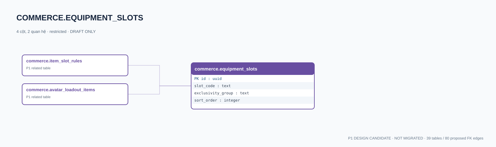

# commerce.equipment_slots — P1 DATA DICTIONARY

**Status:** DRAFT / NOT MIGRATED · **Owner:** commerce · **Data classification:** restricted

Danh mục vị trí trang bị; không hardcode thành từng cột User.

## Direct relationship preview

## Columns (4)
| Column | Candidate PostgreSQL type | Key | Nullable | Default |
|---|---|---|---|---|
| `id` | `uuid` | PK | NO | — |
| `slot_code` | `text` | — | NO | — |
| `exclusivity_group` | `text` | — | YES | — |
| `sort_order` | `integer` | — | NO | — |

## Outbound foreign keys (0)
- None

## Inbound foreign keys (2)
- [commerce.item_slot_rules](commerce.item_slot_rules.md).`equipment_slot_id` → `id`
- [commerce.avatar_loadout_items](commerce.avatar_loadout_items.md).`equipment_slot_id` → `id`

## Proposed integrity
**Unique constraints:** No additional scoped UNIQUE specified yet.

**Check/invariant and domain guard:**
- codes aligned 2D/3D avatar spec

**Indexes:** `(sort_order)`

## Required implementation and review
- Evaluate tenant/organization scope and child PII, no direct browser/MCP SQL.
- Verify FK, composite tenant conditions, status machine, optimistic revision, immutable business history, RLS allow-policy **after** SSO source audit.
- Test authorized and unauthorized roles, concurrency and referential integrity in disposable PostgreSQL **only after migration PR exists**.
- Cross-check UI screen IDs/typed API contracts; log P0/P1 decision conflicts before freezing.
