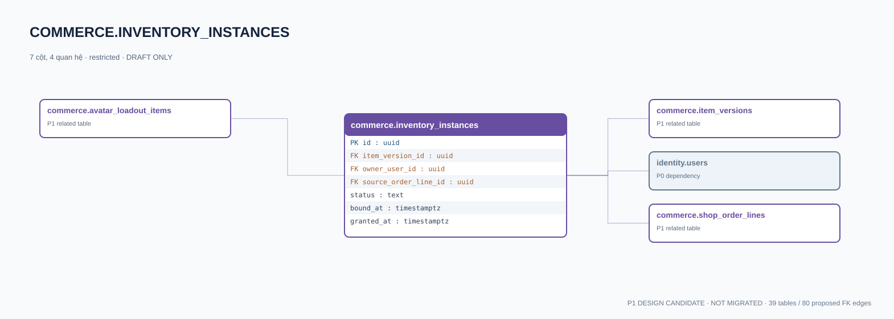

# commerce.inventory_instances — P1 DATA DICTIONARY

**Status:** DRAFT / NOT MIGRATED · **Owner:** commerce · **Data classification:** restricted

Bản quyền sở hữu cá thể duy nhất, độc lập item definition/version.

## Direct relationship preview

## Columns (7)
| Column | Candidate PostgreSQL type | Key | Nullable | Default |
|---|---|---|---|---|
| `id` | `uuid` | PK | NO | — |
| `item_version_id` | `uuid` | FK → [commerce.item_versions](commerce.item_versions.md).`id` | NO | — |
| `owner_user_id` | `uuid` | FK → [identity.users](../../tables/identity.users.md).`id` | NO | — |
| `source_order_line_id` | `uuid` | FK → [commerce.shop_order_lines](commerce.shop_order_lines.md).`id` | YES | — |
| `status` | `text` | — | NO | `owned` |
| `bound_at` | `timestamptz` | — | YES | — |
| `granted_at` | `timestamptz` | — | NO | `now()` |

## Outbound foreign keys (3)
- `item_version_id` → [commerce.item_versions](commerce.item_versions.md).`id` (P1)
- `owner_user_id` → [identity.users](../../tables/identity.users.md).`id` (P0)
- `source_order_line_id` → [commerce.shop_order_lines](commerce.shop_order_lines.md).`id` (P1)

## Inbound foreign keys (1)
- [commerce.avatar_loadout_items](commerce.avatar_loadout_items.md).`inventory_instance_id` → `id`

## Proposed integrity
**Unique constraints:** No additional scoped UNIQUE specified yet.

**Check/invariant and domain guard:**
- audit ownership transfer via future inventory_events
- single owner; no peer trade for minors

**Indexes:** `(owner_user_id,status)`

## Required implementation and review
- Evaluate tenant/organization scope and child PII, no direct browser/MCP SQL.
- Verify FK, composite tenant conditions, status machine, optimistic revision, immutable business history, RLS allow-policy **after** SSO source audit.
- Test authorized and unauthorized roles, concurrency and referential integrity in disposable PostgreSQL **only after migration PR exists**.
- Cross-check UI screen IDs/typed API contracts; log P0/P1 decision conflicts before freezing.
