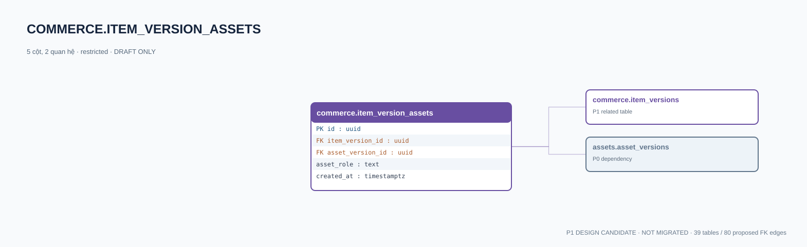

# commerce.item_version_assets — P1 DATA DICTIONARY

**Status:** DRAFT / NOT MIGRATED · **Owner:** commerce · **Data classification:** restricted

N–N vật phẩm ↔ bản asset đã được duyệt.

## Direct relationship preview

## Columns (5)
| Column | Candidate PostgreSQL type | Key | Nullable | Default |
|---|---|---|---|---|
| `id` | `uuid` | PK | NO | — |
| `item_version_id` | `uuid` | FK → [commerce.item_versions](commerce.item_versions.md).`id` | NO | — |
| `asset_version_id` | `uuid` | FK → [assets.asset_versions](../../tables/assets.asset_versions.md).`id` | NO | — |
| `asset_role` | `text` | — | NO | — |
| `created_at` | `timestamptz` | — | NO | `now()` |

## Outbound foreign keys (2)
- `item_version_id` → [commerce.item_versions](commerce.item_versions.md).`id` (P1)
- `asset_version_id` → [assets.asset_versions](../../tables/assets.asset_versions.md).`id` (P0)

## Inbound foreign keys (0)
- None

## Proposed integrity
**Unique constraints:** `(item_version_id,asset_version_id,asset_role)`

**Check/invariant and domain guard:**
- asset_version rights approved before publish

**Indexes:** `(item_version_id,asset_role)`

## Required implementation and review
- Evaluate tenant/organization scope and child PII, no direct browser/MCP SQL.
- Verify FK, composite tenant conditions, status machine, optimistic revision, immutable business history, RLS allow-policy **after** SSO source audit.
- Test authorized and unauthorized roles, concurrency and referential integrity in disposable PostgreSQL **only after migration PR exists**.
- Cross-check UI screen IDs/typed API contracts; log P0/P1 decision conflicts before freezing.
