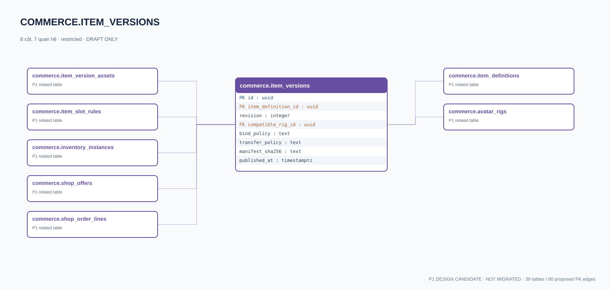

# commerce.item_versions — P1 DATA DICTIONARY

**Status:** DRAFT / NOT MIGRATED · **Owner:** commerce · **Data classification:** restricted

Bản phát hành cosmetic/version/rig and binding policy.

## Direct relationship preview

## Columns (8)
| Column | Candidate PostgreSQL type | Key | Nullable | Default |
|---|---|---|---|---|
| `id` | `uuid` | PK | NO | — |
| `item_definition_id` | `uuid` | FK → [commerce.item_definitions](commerce.item_definitions.md).`id` | NO | — |
| `revision` | `integer` | — | NO | — |
| `compatible_rig_id` | `uuid` | FK → [commerce.avatar_rigs](commerce.avatar_rigs.md).`id` | YES | — |
| `bind_policy` | `text` | — | NO | — |
| `transfer_policy` | `text` | — | NO | — |
| `manifest_sha256` | `text` | — | NO | — |
| `published_at` | `timestamptz` | — | YES | — |

## Outbound foreign keys (2)
- `item_definition_id` → [commerce.item_definitions](commerce.item_definitions.md).`id` (P1)
- `compatible_rig_id` → [commerce.avatar_rigs](commerce.avatar_rigs.md).`id` (P1)

## Inbound foreign keys (5)
- [commerce.item_version_assets](commerce.item_version_assets.md).`item_version_id` → `id`
- [commerce.item_slot_rules](commerce.item_slot_rules.md).`item_version_id` → `id`
- [commerce.inventory_instances](commerce.inventory_instances.md).`item_version_id` → `id`
- [commerce.shop_offers](commerce.shop_offers.md).`item_version_id` → `id`
- [commerce.shop_order_lines](commerce.shop_order_lines.md).`item_version_id` → `id`

## Proposed integrity
**Unique constraints:** `(item_definition_id,revision)`

**Check/invariant and domain guard:**
- revision >= 1
- published item immutable
- cosmetics no ranked advantages

**Indexes:** `(compatible_rig_id,published_at)`

## Required implementation and review
- Evaluate tenant/organization scope and child PII, no direct browser/MCP SQL.
- Verify FK, composite tenant conditions, status machine, optimistic revision, immutable business history, RLS allow-policy **after** SSO source audit.
- Test authorized and unauthorized roles, concurrency and referential integrity in disposable PostgreSQL **only after migration PR exists**.
- Cross-check UI screen IDs/typed API contracts; log P0/P1 decision conflicts before freezing.
