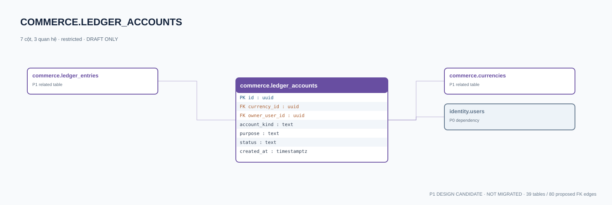

# commerce.ledger_accounts — P1 DATA DICTIONARY

**Status:** DRAFT / NOT MIGRATED · **Owner:** commerce · **Data classification:** restricted

Tài khoản ledger theo currency và chủ thể, tách user/system.

## Direct relationship preview

## Columns (7)
| Column | Candidate PostgreSQL type | Key | Nullable | Default |
|---|---|---|---|---|
| `id` | `uuid` | PK | NO | — |
| `currency_id` | `uuid` | FK → [commerce.currencies](commerce.currencies.md).`id` | NO | — |
| `owner_user_id` | `uuid` | FK → [identity.users](../../tables/identity.users.md).`id` | YES | — |
| `account_kind` | `text` | — | NO | — |
| `purpose` | `text` | — | NO | — |
| `status` | `text` | — | NO | `active` |
| `created_at` | `timestamptz` | — | NO | `now()` |

## Outbound foreign keys (2)
- `currency_id` → [commerce.currencies](commerce.currencies.md).`id` (P1)
- `owner_user_id` → [identity.users](../../tables/identity.users.md).`id` (P0)

## Inbound foreign keys (1)
- [commerce.ledger_entries](commerce.ledger_entries.md).`account_id` → `id`

## Proposed integrity
**Unique constraints:** No additional scoped UNIQUE specified yet.

**Check/invariant and domain guard:**
- system account requires owner null; user account requires user FK
- scope+purpose uniqueness must be approved

**Indexes:** `(currency_id,owner_user_id,purpose)`

## Required implementation and review
- Evaluate tenant/organization scope and child PII, no direct browser/MCP SQL.
- Verify FK, composite tenant conditions, status machine, optimistic revision, immutable business history, RLS allow-policy **after** SSO source audit.
- Test authorized and unauthorized roles, concurrency and referential integrity in disposable PostgreSQL **only after migration PR exists**.
- Cross-check UI screen IDs/typed API contracts; log P0/P1 decision conflicts before freezing.
