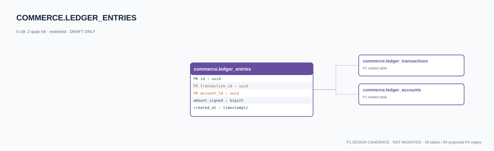

# commerce.ledger_entries — P1 DATA DICTIONARY

**Status:** DRAFT / NOT MIGRATED · **Owner:** commerce · **Data classification:** restricted

Double-entry signed amount; tổng 0 theo transaction/currency phải kiểm tra atomically.

## Direct relationship preview

## Columns (5)
| Column | Candidate PostgreSQL type | Key | Nullable | Default |
|---|---|---|---|---|
| `id` | `uuid` | PK | NO | — |
| `transaction_id` | `uuid` | FK → [commerce.ledger_transactions](commerce.ledger_transactions.md).`id` | NO | — |
| `account_id` | `uuid` | FK → [commerce.ledger_accounts](commerce.ledger_accounts.md).`id` | NO | — |
| `amount_signed` | `bigint` | — | NO | — |
| `created_at` | `timestamptz` | — | NO | `now()` |

## Outbound foreign keys (2)
- `transaction_id` → [commerce.ledger_transactions](commerce.ledger_transactions.md).`id` (P1)
- `account_id` → [commerce.ledger_accounts](commerce.ledger_accounts.md).`id` (P1)

## Inbound foreign keys (0)
- None

## Proposed integrity
**Unique constraints:** No additional scoped UNIQUE specified yet.

**Check/invariant and domain guard:**
- amount_signed <> 0
- SUM(amount_signed) per transaction and currency = 0; enforce via authorized posting service/deferred DB review
- non-negative available funds guard required

**Indexes:** `(transaction_id,account_id)`, `(account_id,created_at)`

## Required implementation and review
- Evaluate tenant/organization scope and child PII, no direct browser/MCP SQL.
- Verify FK, composite tenant conditions, status machine, optimistic revision, immutable business history, RLS allow-policy **after** SSO source audit.
- Test authorized and unauthorized roles, concurrency and referential integrity in disposable PostgreSQL **only after migration PR exists**.
- Cross-check UI screen IDs/typed API contracts; log P0/P1 decision conflicts before freezing.
