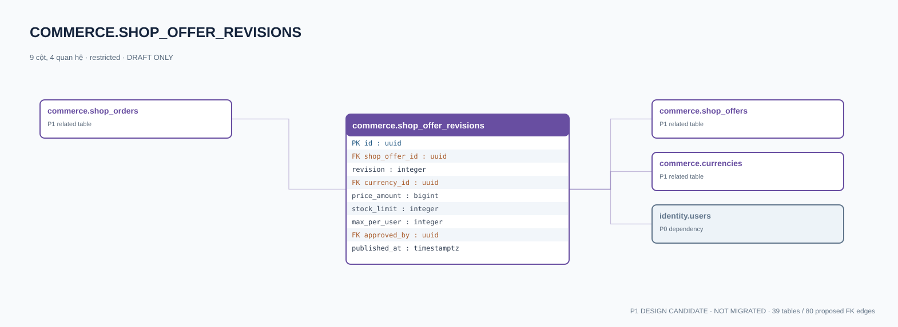

# commerce.shop_offer_revisions — P1 DATA DICTIONARY

**Status:** DRAFT / NOT MIGRATED · **Owner:** commerce · **Data classification:** restricted

Bản giá/số lượng/kho hàng/version; không đổi giá đã dùng trong đơn.

## Direct relationship preview

## Columns (9)
| Column | Candidate PostgreSQL type | Key | Nullable | Default |
|---|---|---|---|---|
| `id` | `uuid` | PK | NO | — |
| `shop_offer_id` | `uuid` | FK → [commerce.shop_offers](commerce.shop_offers.md).`id` | NO | — |
| `revision` | `integer` | — | NO | — |
| `currency_id` | `uuid` | FK → [commerce.currencies](commerce.currencies.md).`id` | NO | — |
| `price_amount` | `bigint` | — | NO | — |
| `stock_limit` | `integer` | — | YES | — |
| `max_per_user` | `integer` | — | YES | — |
| `approved_by` | `uuid` | FK → [identity.users](../../tables/identity.users.md).`id` | YES | — |
| `published_at` | `timestamptz` | — | YES | — |

## Outbound foreign keys (3)
- `shop_offer_id` → [commerce.shop_offers](commerce.shop_offers.md).`id` (P1)
- `currency_id` → [commerce.currencies](commerce.currencies.md).`id` (P1)
- `approved_by` → [identity.users](../../tables/identity.users.md).`id` (P0)

## Inbound foreign keys (1)
- [commerce.shop_orders](commerce.shop_orders.md).`offer_revision_id` → `id`

## Proposed integrity
**Unique constraints:** `(shop_offer_id,revision)`

**Check/invariant and domain guard:**
- price_amount >= 0
- stock_limit IS NULL OR stock_limit >= 0
- published offer revision immutable

**Indexes:** `(shop_offer_id,revision DESC)`

## Required implementation and review
- Evaluate tenant/organization scope and child PII, no direct browser/MCP SQL.
- Verify FK, composite tenant conditions, status machine, optimistic revision, immutable business history, RLS allow-policy **after** SSO source audit.
- Test authorized and unauthorized roles, concurrency and referential integrity in disposable PostgreSQL **only after migration PR exists**.
- Cross-check UI screen IDs/typed API contracts; log P0/P1 decision conflicts before freezing.
