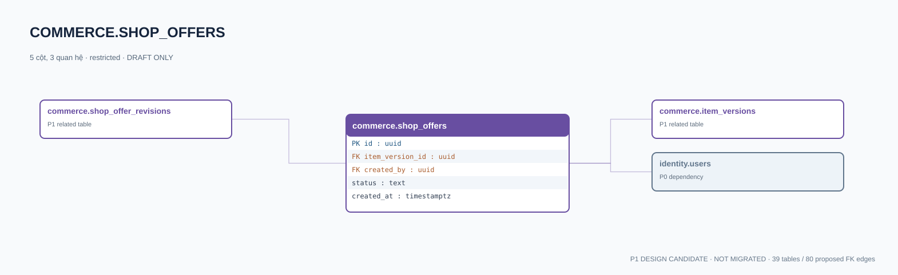

# commerce.shop_offers — P1 DATA DICTIONARY

**Status:** DRAFT / NOT MIGRATED · **Owner:** commerce · **Data classification:** restricted

Đề nghị bán chính thức, không phải marketplace ngang hàng.

## Direct relationship preview

## Columns (5)
| Column | Candidate PostgreSQL type | Key | Nullable | Default |
|---|---|---|---|---|
| `id` | `uuid` | PK | NO | — |
| `item_version_id` | `uuid` | FK → [commerce.item_versions](commerce.item_versions.md).`id` | NO | — |
| `created_by` | `uuid` | FK → [identity.users](../../tables/identity.users.md).`id` | NO | — |
| `status` | `text` | — | NO | `draft` |
| `created_at` | `timestamptz` | — | NO | `now()` |

## Outbound foreign keys (2)
- `item_version_id` → [commerce.item_versions](commerce.item_versions.md).`id` (P1)
- `created_by` → [identity.users](../../tables/identity.users.md).`id` (P0)

## Inbound foreign keys (1)
- [commerce.shop_offer_revisions](commerce.shop_offer_revisions.md).`shop_offer_id` → `id`

## Proposed integrity
**Unique constraints:** No additional scoped UNIQUE specified yet.

**Check/invariant and domain guard:**
- only approved official shop publisher may publish

**Indexes:** `(status,created_at)`

## Required implementation and review
- Evaluate tenant/organization scope and child PII, no direct browser/MCP SQL.
- Verify FK, composite tenant conditions, status machine, optimistic revision, immutable business history, RLS allow-policy **after** SSO source audit.
- Test authorized and unauthorized roles, concurrency and referential integrity in disposable PostgreSQL **only after migration PR exists**.
- Cross-check UI screen IDs/typed API contracts; log P0/P1 decision conflicts before freezing.
