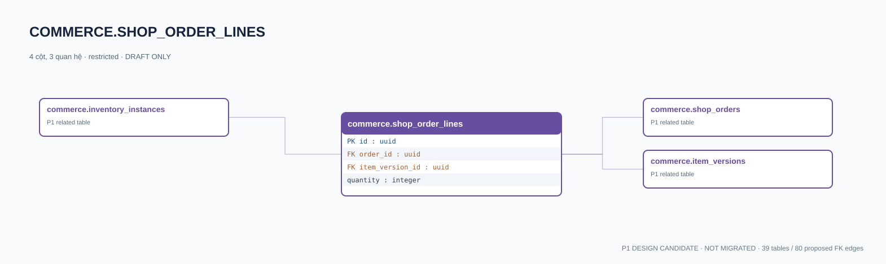

# commerce.shop_order_lines — P1 DATA DICTIONARY

**Status:** DRAFT / NOT MIGRATED · **Owner:** commerce · **Data classification:** restricted

Receipt link item version và số lượng được giao; instance có thể tham chiếu dòng đơn.

## Direct relationship preview

## Columns (4)
| Column | Candidate PostgreSQL type | Key | Nullable | Default |
|---|---|---|---|---|
| `id` | `uuid` | PK | NO | — |
| `order_id` | `uuid` | FK → [commerce.shop_orders](commerce.shop_orders.md).`id` | NO | — |
| `item_version_id` | `uuid` | FK → [commerce.item_versions](commerce.item_versions.md).`id` | NO | — |
| `quantity` | `integer` | — | NO | — |

## Outbound foreign keys (2)
- `order_id` → [commerce.shop_orders](commerce.shop_orders.md).`id` (P1)
- `item_version_id` → [commerce.item_versions](commerce.item_versions.md).`id` (P1)

## Inbound foreign keys (1)
- [commerce.inventory_instances](commerce.inventory_instances.md).`source_order_line_id` → `id`

## Proposed integrity
**Unique constraints:** `(order_id,item_version_id)`

**Check/invariant and domain guard:**
- quantity >= 1
- instance grant tracked by source_order_line_id

**Indexes:** `(order_id)`

## Required implementation and review
- Evaluate tenant/organization scope and child PII, no direct browser/MCP SQL.
- Verify FK, composite tenant conditions, status machine, optimistic revision, immutable business history, RLS allow-policy **after** SSO source audit.
- Test authorized and unauthorized roles, concurrency and referential integrity in disposable PostgreSQL **only after migration PR exists**.
- Cross-check UI screen IDs/typed API contracts; log P0/P1 decision conflicts before freezing.
