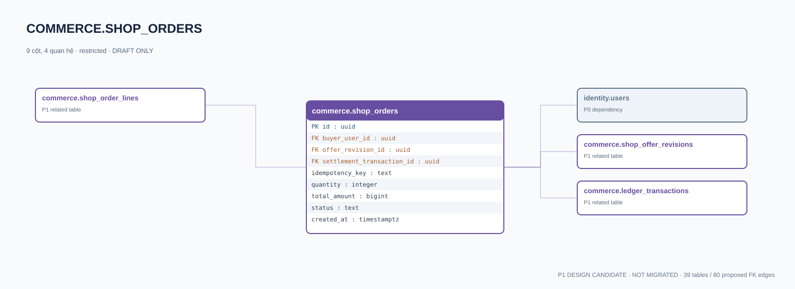

# commerce.shop_orders — P1 DATA DICTIONARY

**Status:** DRAFT / NOT MIGRATED · **Owner:** commerce · **Data classification:** restricted

Đơn mua với idempotency key, buyer, phiên bản giá và ledger settlement.

## Direct relationship preview

## Columns (9)
| Column | Candidate PostgreSQL type | Key | Nullable | Default |
|---|---|---|---|---|
| `id` | `uuid` | PK | NO | — |
| `buyer_user_id` | `uuid` | FK → [identity.users](../../tables/identity.users.md).`id` | NO | — |
| `offer_revision_id` | `uuid` | FK → [commerce.shop_offer_revisions](commerce.shop_offer_revisions.md).`id` | NO | — |
| `settlement_transaction_id` | `uuid` | FK → [commerce.ledger_transactions](commerce.ledger_transactions.md).`id` | YES | — |
| `idempotency_key` | `text` | — | NO | — |
| `quantity` | `integer` | — | NO | — |
| `total_amount` | `bigint` | — | NO | — |
| `status` | `text` | — | NO | `pending` |
| `created_at` | `timestamptz` | — | NO | `now()` |

## Outbound foreign keys (3)
- `buyer_user_id` → [identity.users](../../tables/identity.users.md).`id` (P0)
- `offer_revision_id` → [commerce.shop_offer_revisions](commerce.shop_offer_revisions.md).`id` (P1)
- `settlement_transaction_id` → [commerce.ledger_transactions](commerce.ledger_transactions.md).`id` (P1)

## Inbound foreign keys (1)
- [commerce.shop_order_lines](commerce.shop_order_lines.md).`order_id` → `id`

## Proposed integrity
**Unique constraints:** No additional scoped UNIQUE specified yet.

**Check/invariant and domain guard:**
- quantity >= 1
- total_amount >= 0
- server must enforce price*quantity and atomic stock/ledger/inventory
- minor store eligibility

**Indexes:** `(buyer_user_id,created_at DESC)`

## Required implementation and review
- Evaluate tenant/organization scope and child PII, no direct browser/MCP SQL.
- Verify FK, composite tenant conditions, status machine, optimistic revision, immutable business history, RLS allow-policy **after** SSO source audit.
- Test authorized and unauthorized roles, concurrency and referential integrity in disposable PostgreSQL **only after migration PR exists**.
- Cross-check UI screen IDs/typed API contracts; log P0/P1 decision conflicts before freezing.
