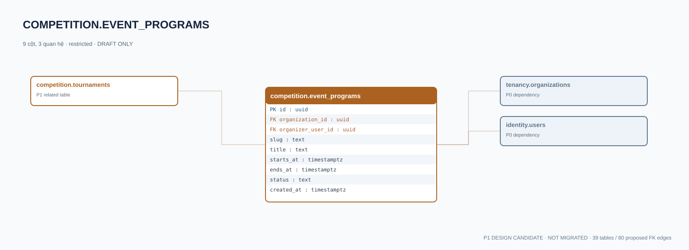

# competition.event_programs — P1 DATA DICTIONARY

**Status:** DRAFT / NOT MIGRATED · **Owner:** competition · **Data classification:** restricted

Sự kiện do tổ chức tổ chức; không đồng nhất CMS campaign.

## Direct relationship preview

## Columns (9)
| Column | Candidate PostgreSQL type | Key | Nullable | Default |
|---|---|---|---|---|
| `id` | `uuid` | PK | NO | — |
| `organization_id` | `uuid` | FK → [tenancy.organizations](../../tables/tenancy.organizations.md).`id` | NO | — |
| `organizer_user_id` | `uuid` | FK → [identity.users](../../tables/identity.users.md).`id` | NO | — |
| `slug` | `text` | — | NO | — |
| `title` | `text` | — | NO | — |
| `starts_at` | `timestamptz` | — | NO | — |
| `ends_at` | `timestamptz` | — | NO | — |
| `status` | `text` | — | NO | `draft` |
| `created_at` | `timestamptz` | — | NO | `now()` |

## Outbound foreign keys (2)
- `organization_id` → [tenancy.organizations](../../tables/tenancy.organizations.md).`id` (P0)
- `organizer_user_id` → [identity.users](../../tables/identity.users.md).`id` (P0)

## Inbound foreign keys (1)
- [competition.tournaments](competition.tournaments.md).`event_program_id` → `id`

## Proposed integrity
**Unique constraints:** `(organization_id,slug)`

**Check/invariant and domain guard:**
- ends_at > starts_at

**Indexes:** `(organization_id,starts_at)`

## Required implementation and review
- Evaluate tenant/organization scope and child PII, no direct browser/MCP SQL.
- Verify FK, composite tenant conditions, status machine, optimistic revision, immutable business history, RLS allow-policy **after** SSO source audit.
- Test authorized and unauthorized roles, concurrency and referential integrity in disposable PostgreSQL **only after migration PR exists**.
- Cross-check UI screen IDs/typed API contracts; log P0/P1 decision conflicts before freezing.
