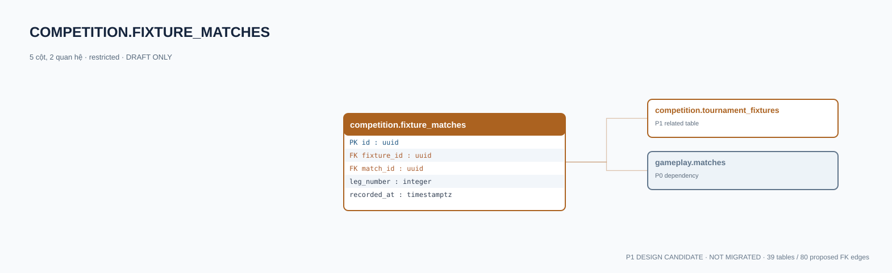

# competition.fixture_matches — P1 DATA DICTIONARY

**Status:** DRAFT / NOT MIGRATED · **Owner:** competition · **Data classification:** restricted

Bảng cầu nối fixture → match đã xác minh từ Game Server.

## Direct relationship preview

## Columns (5)
| Column | Candidate PostgreSQL type | Key | Nullable | Default |
|---|---|---|---|---|
| `id` | `uuid` | PK | NO | — |
| `fixture_id` | `uuid` | FK → [competition.tournament_fixtures](competition.tournament_fixtures.md).`id` | NO | — |
| `match_id` | `uuid` | FK → [gameplay.matches](../../tables/gameplay.matches.md).`id` | NO | — |
| `leg_number` | `integer` | — | NO | — |
| `recorded_at` | `timestamptz` | — | NO | `now()` |

## Outbound foreign keys (2)
- `fixture_id` → [competition.tournament_fixtures](competition.tournament_fixtures.md).`id` (P1)
- `match_id` → [gameplay.matches](../../tables/gameplay.matches.md).`id` (P0)

## Inbound foreign keys (0)
- None

## Proposed integrity
**Unique constraints:** `(fixture_id,leg_number)`

**Check/invariant and domain guard:**
- leg_number > 0
- match Game Version must match tournament; verify before link

**Indexes:** `(fixture_id,leg_number)`

## Required implementation and review
- Evaluate tenant/organization scope and child PII, no direct browser/MCP SQL.
- Verify FK, composite tenant conditions, status machine, optimistic revision, immutable business history, RLS allow-policy **after** SSO source audit.
- Test authorized and unauthorized roles, concurrency and referential integrity in disposable PostgreSQL **only after migration PR exists**.
- Cross-check UI screen IDs/typed API contracts; log P0/P1 decision conflicts before freezing.
