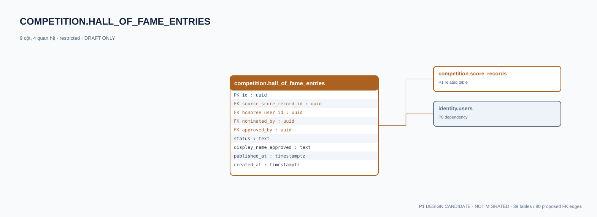

# competition.hall_of_fame_entries — P1 DATA DICTIONARY

**Status:** DRAFT / NOT MIGRATED · **Owner:** competition · **Data classification:** restricted

Vinh danh được phê duyệt riêng, có quyền rút công bố.

## Direct relationship preview

## Columns (9)
| Column | Candidate PostgreSQL type | Key | Nullable | Default |
|---|---|---|---|---|
| `id` | `uuid` | PK | NO | — |
| `source_score_record_id` | `uuid` | FK → [competition.score_records](competition.score_records.md).`id` | NO | — |
| `honoree_user_id` | `uuid` | FK → [identity.users](../../tables/identity.users.md).`id` | NO | — |
| `nominated_by` | `uuid` | FK → [identity.users](../../tables/identity.users.md).`id` | NO | — |
| `approved_by` | `uuid` | FK → [identity.users](../../tables/identity.users.md).`id` | YES | — |
| `status` | `text` | — | NO | `draft` |
| `display_name_approved` | `text` | — | YES | — |
| `published_at` | `timestamptz` | — | YES | — |
| `created_at` | `timestamptz` | — | NO | `now()` |

## Outbound foreign keys (4)
- `source_score_record_id` → [competition.score_records](competition.score_records.md).`id` (P1)
- `honoree_user_id` → [identity.users](../../tables/identity.users.md).`id` (P0)
- `nominated_by` → [identity.users](../../tables/identity.users.md).`id` (P0)
- `approved_by` → [identity.users](../../tables/identity.users.md).`id` (P0)

## Inbound foreign keys (0)
- None

## Proposed integrity
**Unique constraints:** No additional scoped UNIQUE specified yet.

**Check/invariant and domain guard:**
- human approval and guardian visibility required for minors
- withdrawal audit required

**Indexes:** `(status,published_at DESC)`

## Required implementation and review
- Evaluate tenant/organization scope and child PII, no direct browser/MCP SQL.
- Verify FK, composite tenant conditions, status machine, optimistic revision, immutable business history, RLS allow-policy **after** SSO source audit.
- Test authorized and unauthorized roles, concurrency and referential integrity in disposable PostgreSQL **only after migration PR exists**.
- Cross-check UI screen IDs/typed API contracts; log P0/P1 decision conflicts before freezing.
