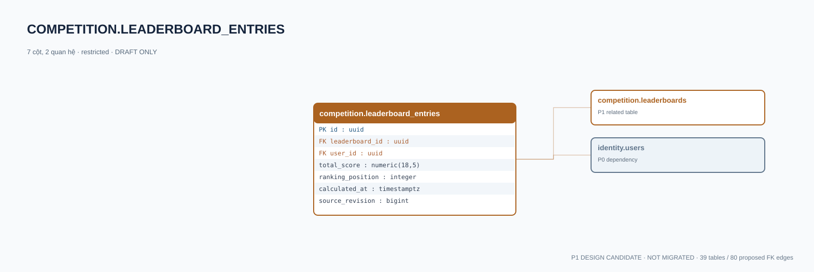

# competition.leaderboard_entries — P1 DATA DICTIONARY

**Status:** DRAFT / NOT MIGRATED · **Owner:** competition · **Data classification:** restricted

Projection tổng điểm/rank có thể tính lại từ score_records.

## Direct relationship preview

## Columns (7)
| Column | Candidate PostgreSQL type | Key | Nullable | Default |
|---|---|---|---|---|
| `id` | `uuid` | PK | NO | — |
| `leaderboard_id` | `uuid` | FK → [competition.leaderboards](competition.leaderboards.md).`id` | NO | — |
| `user_id` | `uuid` | FK → [identity.users](../../tables/identity.users.md).`id` | NO | — |
| `total_score` | `numeric(18,5)` | — | NO | — |
| `ranking_position` | `integer` | — | YES | — |
| `calculated_at` | `timestamptz` | — | NO | — |
| `source_revision` | `bigint` | — | NO | — |

## Outbound foreign keys (2)
- `leaderboard_id` → [competition.leaderboards](competition.leaderboards.md).`id` (P1)
- `user_id` → [identity.users](../../tables/identity.users.md).`id` (P0)

## Inbound foreign keys (0)
- None

## Proposed integrity
**Unique constraints:** `(leaderboard_id,user_id)`

**Check/invariant and domain guard:**
- source_revision > 0
- projection must never grant Coin or become grade

**Indexes:** `(leaderboard_id,ranking_position)`

## Required implementation and review
- Evaluate tenant/organization scope and child PII, no direct browser/MCP SQL.
- Verify FK, composite tenant conditions, status machine, optimistic revision, immutable business history, RLS allow-policy **after** SSO source audit.
- Test authorized and unauthorized roles, concurrency and referential integrity in disposable PostgreSQL **only after migration PR exists**.
- Cross-check UI screen IDs/typed API contracts; log P0/P1 decision conflicts before freezing.
