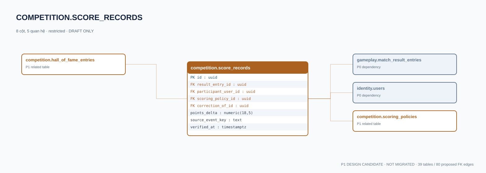

# competition.score_records — P1 DATA DICTIONARY

**Status:** DRAFT / NOT MIGRATED · **Owner:** competition · **Data classification:** restricted

Ledger điểm immutable chứng minh từ entry kết quả authoritative, sửa sai bằng bù.

## Direct relationship preview

## Columns (8)
| Column | Candidate PostgreSQL type | Key | Nullable | Default |
|---|---|---|---|---|
| `id` | `uuid` | PK | NO | — |
| `result_entry_id` | `uuid` | FK → [gameplay.match_result_entries](../../tables/gameplay.match_result_entries.md).`id` | NO | — |
| `participant_user_id` | `uuid` | FK → [identity.users](../../tables/identity.users.md).`id` | NO | — |
| `scoring_policy_id` | `uuid` | FK → [competition.scoring_policies](competition.scoring_policies.md).`id` | NO | — |
| `correction_of_id` | `uuid` | FK → [competition.score_records](competition.score_records.md).`id` | YES | — |
| `points_delta` | `numeric(18,5)` | — | NO | — |
| `source_event_key` | `text` | — | NO | — |
| `verified_at` | `timestamptz` | — | NO | `now()` |

## Outbound foreign keys (4)
- `result_entry_id` → [gameplay.match_result_entries](../../tables/gameplay.match_result_entries.md).`id` (P0)
- `participant_user_id` → [identity.users](../../tables/identity.users.md).`id` (P0)
- `scoring_policy_id` → [competition.scoring_policies](competition.scoring_policies.md).`id` (P1)
- `correction_of_id` → [competition.score_records](competition.score_records.md).`id` (P1)

## Inbound foreign keys (2)
- [competition.score_records](competition.score_records.md).`correction_of_id` → `id`
- [competition.hall_of_fame_entries](competition.hall_of_fame_entries.md).`source_score_record_id` → `id`

## Proposed integrity
**Unique constraints:** No additional scoped UNIQUE specified yet.

**Check/invariant and domain guard:**
- immutable; never update verified score records
- policy game_version must match source match result
- correction references prior source with audit

**Indexes:** `(participant_user_id,scoring_policy_id,verified_at DESC)`

## Required implementation and review
- Evaluate tenant/organization scope and child PII, no direct browser/MCP SQL.
- Verify FK, composite tenant conditions, status machine, optimistic revision, immutable business history, RLS allow-policy **after** SSO source audit.
- Test authorized and unauthorized roles, concurrency and referential integrity in disposable PostgreSQL **only after migration PR exists**.
- Cross-check UI screen IDs/typed API contracts; log P0/P1 decision conflicts before freezing.
