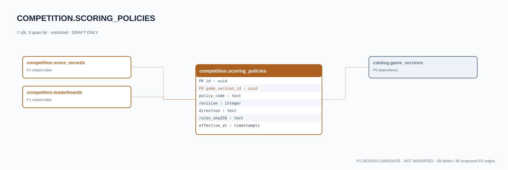

# competition.scoring_policies — P1 DATA DICTIONARY

**Status:** DRAFT / NOT MIGRATED · **Owner:** competition · **Data classification:** restricted

Phiên bản chính sách tính điểm, normalize/tie break theo game.

## Direct relationship preview

## Columns (7)
| Column | Candidate PostgreSQL type | Key | Nullable | Default |
|---|---|---|---|---|
| `id` | `uuid` | PK | NO | — |
| `game_version_id` | `uuid` | FK → [catalog.game_versions](../../tables/catalog.game_versions.md).`id` | NO | — |
| `policy_code` | `text` | — | NO | — |
| `revision` | `integer` | — | NO | — |
| `direction` | `text` | — | NO | — |
| `rules_sha256` | `text` | — | NO | — |
| `effective_at` | `timestamptz` | — | YES | — |

## Outbound foreign keys (1)
- `game_version_id` → [catalog.game_versions](../../tables/catalog.game_versions.md).`id` (P0)

## Inbound foreign keys (2)
- [competition.score_records](competition.score_records.md).`scoring_policy_id` → `id`
- [competition.leaderboards](competition.leaderboards.md).`scoring_policy_id` → `id`

## Proposed integrity
**Unique constraints:** `(game_version_id,policy_code,revision)`

**Check/invariant and domain guard:**
- revision > 0
- rules_sha256 canonical signed policy hash

**Indexes:** `(game_version_id,policy_code,revision DESC)`

## Required implementation and review
- Evaluate tenant/organization scope and child PII, no direct browser/MCP SQL.
- Verify FK, composite tenant conditions, status machine, optimistic revision, immutable business history, RLS allow-policy **after** SSO source audit.
- Test authorized and unauthorized roles, concurrency and referential integrity in disposable PostgreSQL **only after migration PR exists**.
- Cross-check UI screen IDs/typed API contracts; log P0/P1 decision conflicts before freezing.
