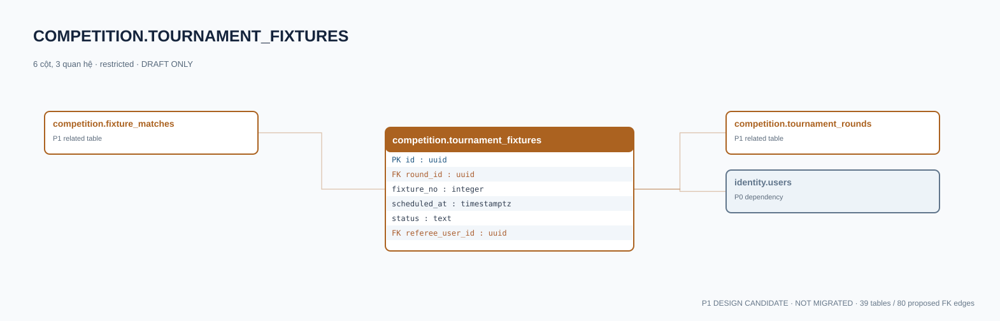

# competition.tournament_fixtures — P1 DATA DICTIONARY

**Status:** DRAFT / NOT MIGRATED · **Owner:** competition · **Data classification:** restricted

Cặp đấu theo vòng, có thể liên kết nhiều match rematch.

## Direct relationship preview

## Columns (6)
| Column | Candidate PostgreSQL type | Key | Nullable | Default |
|---|---|---|---|---|
| `id` | `uuid` | PK | NO | — |
| `round_id` | `uuid` | FK → [competition.tournament_rounds](competition.tournament_rounds.md).`id` | NO | — |
| `fixture_no` | `integer` | — | NO | — |
| `scheduled_at` | `timestamptz` | — | YES | — |
| `status` | `text` | — | NO | `scheduled` |
| `referee_user_id` | `uuid` | FK → [identity.users](../../tables/identity.users.md).`id` | YES | — |

## Outbound foreign keys (2)
- `round_id` → [competition.tournament_rounds](competition.tournament_rounds.md).`id` (P1)
- `referee_user_id` → [identity.users](../../tables/identity.users.md).`id` (P0)

## Inbound foreign keys (1)
- [competition.fixture_matches](competition.fixture_matches.md).`fixture_id` → `id`

## Proposed integrity
**Unique constraints:** `(round_id,fixture_no)`

**Check/invariant and domain guard:**
- fixture_no >= 1

**Indexes:** `(round_id,scheduled_at)`

## Required implementation and review
- Evaluate tenant/organization scope and child PII, no direct browser/MCP SQL.
- Verify FK, composite tenant conditions, status machine, optimistic revision, immutable business history, RLS allow-policy **after** SSO source audit.
- Test authorized and unauthorized roles, concurrency and referential integrity in disposable PostgreSQL **only after migration PR exists**.
- Cross-check UI screen IDs/typed API contracts; log P0/P1 decision conflicts before freezing.
