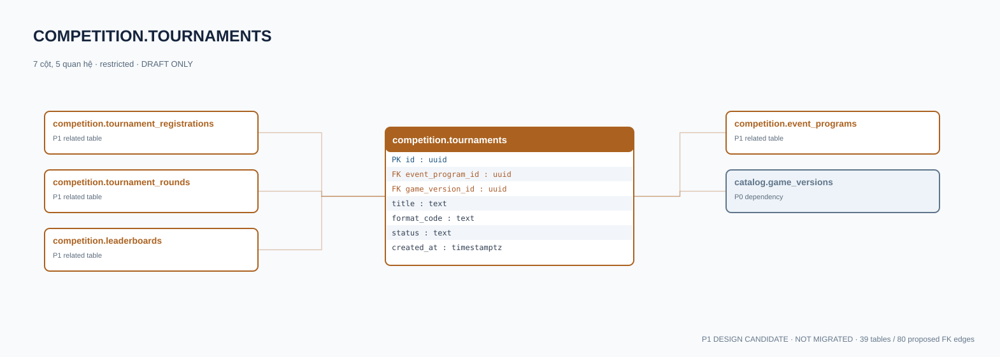

# competition.tournaments — P1 DATA DICTIONARY

**Status:** DRAFT / NOT MIGRATED · **Owner:** competition · **Data classification:** restricted

Giải đấu của event gắn game version và thể thức đã phê duyệt.

## Direct relationship preview

## Columns (7)
| Column | Candidate PostgreSQL type | Key | Nullable | Default |
|---|---|---|---|---|
| `id` | `uuid` | PK | NO | — |
| `event_program_id` | `uuid` | FK → [competition.event_programs](competition.event_programs.md).`id` | NO | — |
| `game_version_id` | `uuid` | FK → [catalog.game_versions](../../tables/catalog.game_versions.md).`id` | NO | — |
| `title` | `text` | — | NO | — |
| `format_code` | `text` | — | NO | — |
| `status` | `text` | — | NO | `draft` |
| `created_at` | `timestamptz` | — | NO | `now()` |

## Outbound foreign keys (2)
- `event_program_id` → [competition.event_programs](competition.event_programs.md).`id` (P1)
- `game_version_id` → [catalog.game_versions](../../tables/catalog.game_versions.md).`id` (P0)

## Inbound foreign keys (3)
- [competition.tournament_registrations](competition.tournament_registrations.md).`tournament_id` → `id`
- [competition.tournament_rounds](competition.tournament_rounds.md).`tournament_id` → `id`
- [competition.leaderboards](competition.leaderboards.md).`tournament_id` → `id`

## Proposed integrity
**Unique constraints:** No additional scoped UNIQUE specified yet.

**Check/invariant and domain guard:**
- format_code must be versioned approved tournament policy

**Indexes:** `(event_program_id,status)`

## Required implementation and review
- Evaluate tenant/organization scope and child PII, no direct browser/MCP SQL.
- Verify FK, composite tenant conditions, status machine, optimistic revision, immutable business history, RLS allow-policy **after** SSO source audit.
- Test authorized and unauthorized roles, concurrency and referential integrity in disposable PostgreSQL **only after migration PR exists**.
- Cross-check UI screen IDs/typed API contracts; log P0/P1 decision conflicts before freezing.
