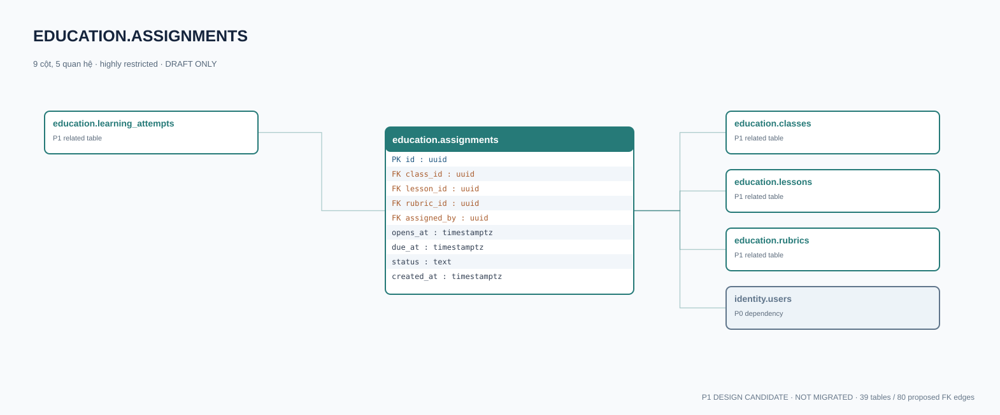

# education.assignments — P1 DATA DICTIONARY

**Status:** DRAFT / NOT MIGRATED · **Owner:** education · **Data classification:** highly restricted

Giáo viên giao bài cho lớp; ràng buộc lesson/rubric revision.

## Direct relationship preview

## Columns (9)
| Column | Candidate PostgreSQL type | Key | Nullable | Default |
|---|---|---|---|---|
| `id` | `uuid` | PK | NO | — |
| `class_id` | `uuid` | FK → [education.classes](education.classes.md).`id` | NO | — |
| `lesson_id` | `uuid` | FK → [education.lessons](education.lessons.md).`id` | NO | — |
| `rubric_id` | `uuid` | FK → [education.rubrics](education.rubrics.md).`id` | YES | — |
| `assigned_by` | `uuid` | FK → [identity.users](../../tables/identity.users.md).`id` | NO | — |
| `opens_at` | `timestamptz` | — | YES | — |
| `due_at` | `timestamptz` | — | YES | — |
| `status` | `text` | — | NO | `draft` |
| `created_at` | `timestamptz` | — | NO | `now()` |

## Outbound foreign keys (4)
- `class_id` → [education.classes](education.classes.md).`id` (P1)
- `lesson_id` → [education.lessons](education.lessons.md).`id` (P1)
- `rubric_id` → [education.rubrics](education.rubrics.md).`id` (P1)
- `assigned_by` → [identity.users](../../tables/identity.users.md).`id` (P0)

## Inbound foreign keys (1)
- [education.learning_attempts](education.learning_attempts.md).`assignment_id` → `id`

## Proposed integrity
**Unique constraints:** No additional scoped UNIQUE specified yet.

**Check/invariant and domain guard:**
- opens_at IS NULL OR due_at IS NULL OR due_at > opens_at
- rubric lesson must match assignment lesson; composite constraint pending

**Indexes:** `(class_id,status,opens_at)`

## Required implementation and review
- Evaluate tenant/organization scope and child PII, no direct browser/MCP SQL.
- Verify FK, composite tenant conditions, status machine, optimistic revision, immutable business history, RLS allow-policy **after** SSO source audit.
- Test authorized and unauthorized roles, concurrency and referential integrity in disposable PostgreSQL **only after migration PR exists**.
- Cross-check UI screen IDs/typed API contracts; log P0/P1 decision conflicts before freezing.
