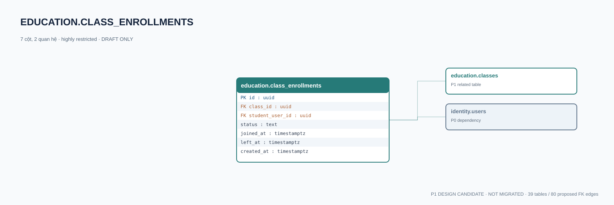

# education.class_enrollments — P1 DATA DICTIONARY

**Status:** DRAFT / NOT MIGRATED · **Owner:** education · **Data classification:** highly restricted

Lịch sử tham gia lớp học; không suy quyền từ việc tồn tại dòng dữ liệu.

## Direct relationship preview

## Columns (7)
| Column | Candidate PostgreSQL type | Key | Nullable | Default |
|---|---|---|---|---|
| `id` | `uuid` | PK | NO | — |
| `class_id` | `uuid` | FK → [education.classes](education.classes.md).`id` | NO | — |
| `student_user_id` | `uuid` | FK → [identity.users](../../tables/identity.users.md).`id` | NO | — |
| `status` | `text` | — | NO | `invited` |
| `joined_at` | `timestamptz` | — | YES | — |
| `left_at` | `timestamptz` | — | YES | — |
| `created_at` | `timestamptz` | — | NO | `now()` |

## Outbound foreign keys (2)
- `class_id` → [education.classes](education.classes.md).`id` (P1)
- `student_user_id` → [identity.users](../../tables/identity.users.md).`id` (P0)

## Inbound foreign keys (0)
- None

## Proposed integrity
**Unique constraints:** `(class_id,student_user_id)`

**Check/invariant and domain guard:**
- student must be permitted under org and age policy
- left_at IS NULL OR joined_at IS NOT NULL

**Indexes:** `(student_user_id,status)`

## Required implementation and review
- Evaluate tenant/organization scope and child PII, no direct browser/MCP SQL.
- Verify FK, composite tenant conditions, status machine, optimistic revision, immutable business history, RLS allow-policy **after** SSO source audit.
- Test authorized and unauthorized roles, concurrency and referential integrity in disposable PostgreSQL **only after migration PR exists**.
- Cross-check UI screen IDs/typed API contracts; log P0/P1 decision conflicts before freezing.
