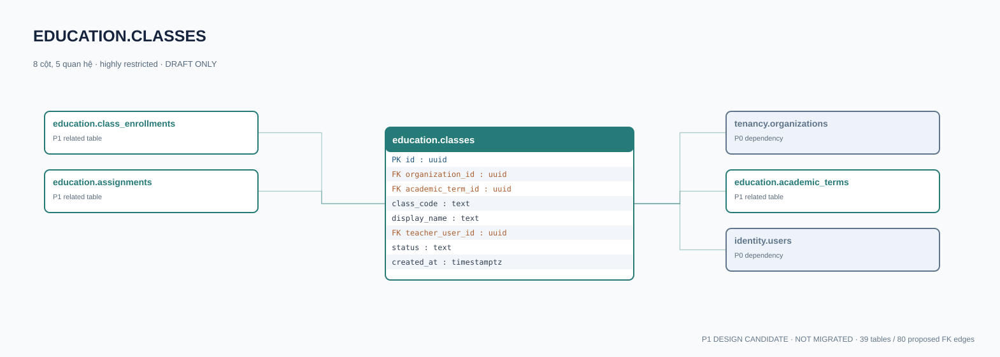

# education.classes — P1 DATA DICTIONARY

**Status:** DRAFT / NOT MIGRATED · **Owner:** education · **Data classification:** highly restricted

Lớp học thuộc tổ chức và niên khóa; phân quyền theo membership tổ chức.

## Direct relationship preview

## Columns (8)
| Column | Candidate PostgreSQL type | Key | Nullable | Default |
|---|---|---|---|---|
| `id` | `uuid` | PK | NO | — |
| `organization_id` | `uuid` | FK → [tenancy.organizations](../../tables/tenancy.organizations.md).`id` | NO | — |
| `academic_term_id` | `uuid` | FK → [education.academic_terms](education.academic_terms.md).`id` | NO | — |
| `class_code` | `text` | — | NO | — |
| `display_name` | `text` | — | NO | — |
| `teacher_user_id` | `uuid` | FK → [identity.users](../../tables/identity.users.md).`id` | NO | — |
| `status` | `text` | — | NO | `draft` |
| `created_at` | `timestamptz` | — | NO | `now()` |

## Outbound foreign keys (3)
- `organization_id` → [tenancy.organizations](../../tables/tenancy.organizations.md).`id` (P0)
- `academic_term_id` → [education.academic_terms](education.academic_terms.md).`id` (P1)
- `teacher_user_id` → [identity.users](../../tables/identity.users.md).`id` (P0)

## Inbound foreign keys (2)
- [education.class_enrollments](education.class_enrollments.md).`class_id` → `id`
- [education.assignments](education.assignments.md).`class_id` → `id`

## Proposed integrity
**Unique constraints:** `(organization_id,academic_term_id,class_code)`

**Check/invariant and domain guard:**
- term and class must share same organization (composite FK to finalize)

**Indexes:** `(organization_id,status)`

## Required implementation and review
- Evaluate tenant/organization scope and child PII, no direct browser/MCP SQL.
- Verify FK, composite tenant conditions, status machine, optimistic revision, immutable business history, RLS allow-policy **after** SSO source audit.
- Test authorized and unauthorized roles, concurrency and referential integrity in disposable PostgreSQL **only after migration PR exists**.
- Cross-check UI screen IDs/typed API contracts; log P0/P1 decision conflicts before freezing.
