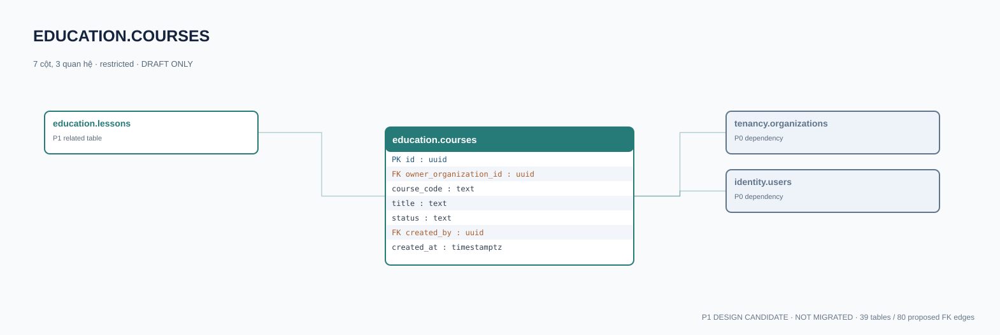

# education.courses — P1 DATA DICTIONARY

**Status:** DRAFT / NOT MIGRATED · **Owner:** education · **Data classification:** restricted

Khóa/chương trình học dùng lại qua nhiều lớp; có thể do tổ chức sở hữu.

## Direct relationship preview

## Columns (7)
| Column | Candidate PostgreSQL type | Key | Nullable | Default |
|---|---|---|---|---|
| `id` | `uuid` | PK | NO | — |
| `owner_organization_id` | `uuid` | FK → [tenancy.organizations](../../tables/tenancy.organizations.md).`id` | YES | — |
| `course_code` | `text` | — | NO | — |
| `title` | `text` | — | NO | — |
| `status` | `text` | — | NO | `draft` |
| `created_by` | `uuid` | FK → [identity.users](../../tables/identity.users.md).`id` | NO | — |
| `created_at` | `timestamptz` | — | NO | `now()` |

## Outbound foreign keys (2)
- `owner_organization_id` → [tenancy.organizations](../../tables/tenancy.organizations.md).`id` (P0)
- `created_by` → [identity.users](../../tables/identity.users.md).`id` (P0)

## Inbound foreign keys (1)
- [education.lessons](education.lessons.md).`course_id` → `id`

## Proposed integrity
**Unique constraints:** No additional scoped UNIQUE specified yet.

**Check/invariant and domain guard:**
- Course code globally unique by initial proposal; confirm scope

**Indexes:** `(status,course_code)`

## Required implementation and review
- Evaluate tenant/organization scope and child PII, no direct browser/MCP SQL.
- Verify FK, composite tenant conditions, status machine, optimistic revision, immutable business history, RLS allow-policy **after** SSO source audit.
- Test authorized and unauthorized roles, concurrency and referential integrity in disposable PostgreSQL **only after migration PR exists**.
- Cross-check UI screen IDs/typed API contracts; log P0/P1 decision conflicts before freezing.
