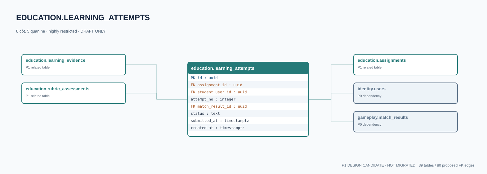

# education.learning_attempts — P1 DATA DICTIONARY

**Status:** DRAFT / NOT MIGRATED · **Owner:** education · **Data classification:** highly restricted

Lượt nộp bài cá nhân; kết quả game chỉ là bằng chứng, không phải điểm học thuật.

## Direct relationship preview

## Columns (8)
| Column | Candidate PostgreSQL type | Key | Nullable | Default |
|---|---|---|---|---|
| `id` | `uuid` | PK | NO | — |
| `assignment_id` | `uuid` | FK → [education.assignments](education.assignments.md).`id` | NO | — |
| `student_user_id` | `uuid` | FK → [identity.users](../../tables/identity.users.md).`id` | NO | — |
| `attempt_no` | `integer` | — | NO | — |
| `match_result_id` | `uuid` | FK → [gameplay.match_results](../../tables/gameplay.match_results.md).`id` | YES | — |
| `status` | `text` | — | NO | `in_progress` |
| `submitted_at` | `timestamptz` | — | YES | — |
| `created_at` | `timestamptz` | — | NO | `now()` |

## Outbound foreign keys (3)
- `assignment_id` → [education.assignments](education.assignments.md).`id` (P1)
- `student_user_id` → [identity.users](../../tables/identity.users.md).`id` (P0)
- `match_result_id` → [gameplay.match_results](../../tables/gameplay.match_results.md).`id` (P0)

## Inbound foreign keys (2)
- [education.learning_evidence](education.learning_evidence.md).`attempt_id` → `id`
- [education.rubric_assessments](education.rubric_assessments.md).`attempt_id` → `id`

## Proposed integrity
**Unique constraints:** `(assignment_id,student_user_id,attempt_no)`

**Check/invariant and domain guard:**
- attempt_no > 0
- student active class enrollment and match participation must be checked

**Indexes:** `(student_user_id,submitted_at DESC)`

## Required implementation and review
- Evaluate tenant/organization scope and child PII, no direct browser/MCP SQL.
- Verify FK, composite tenant conditions, status machine, optimistic revision, immutable business history, RLS allow-policy **after** SSO source audit.
- Test authorized and unauthorized roles, concurrency and referential integrity in disposable PostgreSQL **only after migration PR exists**.
- Cross-check UI screen IDs/typed API contracts; log P0/P1 decision conflicts before freezing.
