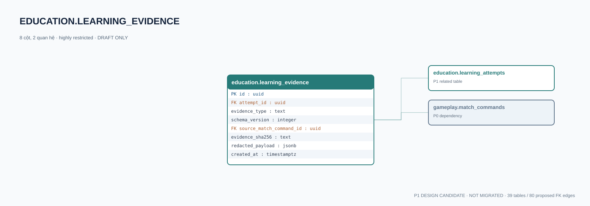

# education.learning_evidence — P1 DATA DICTIONARY

**Status:** DRAFT / NOT MIGRATED · **Owner:** education · **Data classification:** highly restricted

Minh chứng theo lượt và schema version, mặc định riêng tư.

## Direct relationship preview

## Columns (8)
| Column | Candidate PostgreSQL type | Key | Nullable | Default |
|---|---|---|---|---|
| `id` | `uuid` | PK | NO | — |
| `attempt_id` | `uuid` | FK → [education.learning_attempts](education.learning_attempts.md).`id` | NO | — |
| `evidence_type` | `text` | — | NO | — |
| `schema_version` | `integer` | — | NO | — |
| `source_match_command_id` | `uuid` | FK → [gameplay.match_commands](../../tables/gameplay.match_commands.md).`id` | YES | — |
| `evidence_sha256` | `text` | — | NO | — |
| `redacted_payload` | `jsonb` | — | NO | — |
| `created_at` | `timestamptz` | — | NO | `now()` |

## Outbound foreign keys (2)
- `attempt_id` → [education.learning_attempts](education.learning_attempts.md).`id` (P1)
- `source_match_command_id` → [gameplay.match_commands](../../tables/gameplay.match_commands.md).`id` (P0)

## Inbound foreign keys (0)
- None

## Proposed integrity
**Unique constraints:** No additional scoped UNIQUE specified yet.

**Check/invariant and domain guard:**
- schema_version > 0
- evidence_sha256 is sha256 of canonical evidence data
- never place child PII in generic payload

**Indexes:** `(attempt_id,created_at)`

## Required implementation and review
- Evaluate tenant/organization scope and child PII, no direct browser/MCP SQL.
- Verify FK, composite tenant conditions, status machine, optimistic revision, immutable business history, RLS allow-policy **after** SSO source audit.
- Test authorized and unauthorized roles, concurrency and referential integrity in disposable PostgreSQL **only after migration PR exists**.
- Cross-check UI screen IDs/typed API contracts; log P0/P1 decision conflicts before freezing.
