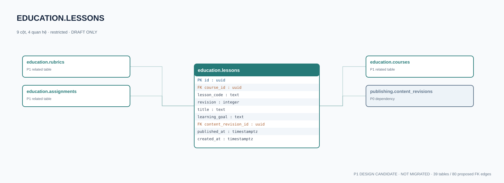

# education.lessons — P1 DATA DICTIONARY

**Status:** DRAFT / NOT MIGRATED · **Owner:** education · **Data classification:** restricted

Bài học phiên bản hóa nội dung để giữ bằng chứng lịch sử.

## Direct relationship preview

## Columns (9)
| Column | Candidate PostgreSQL type | Key | Nullable | Default |
|---|---|---|---|---|
| `id` | `uuid` | PK | NO | — |
| `course_id` | `uuid` | FK → [education.courses](education.courses.md).`id` | NO | — |
| `lesson_code` | `text` | — | NO | — |
| `revision` | `integer` | — | NO | — |
| `title` | `text` | — | NO | — |
| `learning_goal` | `text` | — | NO | — |
| `content_revision_id` | `uuid` | FK → [publishing.content_revisions](../../tables/publishing.content_revisions.md).`id` | YES | — |
| `published_at` | `timestamptz` | — | YES | — |
| `created_at` | `timestamptz` | — | NO | `now()` |

## Outbound foreign keys (2)
- `course_id` → [education.courses](education.courses.md).`id` (P1)
- `content_revision_id` → [publishing.content_revisions](../../tables/publishing.content_revisions.md).`id` (P0)

## Inbound foreign keys (2)
- [education.rubrics](education.rubrics.md).`lesson_id` → `id`
- [education.assignments](education.assignments.md).`lesson_id` → `id`

## Proposed integrity
**Unique constraints:** `(course_id,lesson_code,revision)`

**Check/invariant and domain guard:**
- revision > 0
- published revision immutable via application + DB guard before release

**Indexes:** `(course_id,lesson_code,revision DESC)`

## Required implementation and review
- Evaluate tenant/organization scope and child PII, no direct browser/MCP SQL.
- Verify FK, composite tenant conditions, status machine, optimistic revision, immutable business history, RLS allow-policy **after** SSO source audit.
- Test authorized and unauthorized roles, concurrency and referential integrity in disposable PostgreSQL **only after migration PR exists**.
- Cross-check UI screen IDs/typed API contracts; log P0/P1 decision conflicts before freezing.
