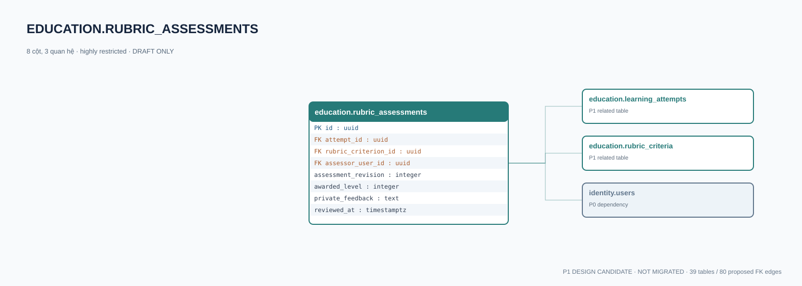

# education.rubric_assessments — P1 DATA DICTIONARY

**Status:** DRAFT / NOT MIGRATED · **Owner:** education · **Data classification:** highly restricted

Kết quả giáo viên nhận xét tiêu chí theo revision; lịch sử không ghi đè.

## Direct relationship preview

## Columns (8)
| Column | Candidate PostgreSQL type | Key | Nullable | Default |
|---|---|---|---|---|
| `id` | `uuid` | PK | NO | — |
| `attempt_id` | `uuid` | FK → [education.learning_attempts](education.learning_attempts.md).`id` | NO | — |
| `rubric_criterion_id` | `uuid` | FK → [education.rubric_criteria](education.rubric_criteria.md).`id` | NO | — |
| `assessor_user_id` | `uuid` | FK → [identity.users](../../tables/identity.users.md).`id` | NO | — |
| `assessment_revision` | `integer` | — | NO | — |
| `awarded_level` | `integer` | — | NO | — |
| `private_feedback` | `text` | — | YES | — |
| `reviewed_at` | `timestamptz` | — | NO | `now()` |

## Outbound foreign keys (3)
- `attempt_id` → [education.learning_attempts](education.learning_attempts.md).`id` (P1)
- `rubric_criterion_id` → [education.rubric_criteria](education.rubric_criteria.md).`id` (P1)
- `assessor_user_id` → [identity.users](../../tables/identity.users.md).`id` (P0)

## Inbound foreign keys (0)
- None

## Proposed integrity
**Unique constraints:** `(attempt_id,rubric_criterion_id,assessment_revision)`

**Check/invariant and domain guard:**
- assessment_revision > 0
- awarded_level >= 0
- criteria rubric must equal assignment rubric; authorization required

**Indexes:** `(attempt_id,reviewed_at DESC)`

## Required implementation and review
- Evaluate tenant/organization scope and child PII, no direct browser/MCP SQL.
- Verify FK, composite tenant conditions, status machine, optimistic revision, immutable business history, RLS allow-policy **after** SSO source audit.
- Test authorized and unauthorized roles, concurrency and referential integrity in disposable PostgreSQL **only after migration PR exists**.
- Cross-check UI screen IDs/typed API contracts; log P0/P1 decision conflicts before freezing.
