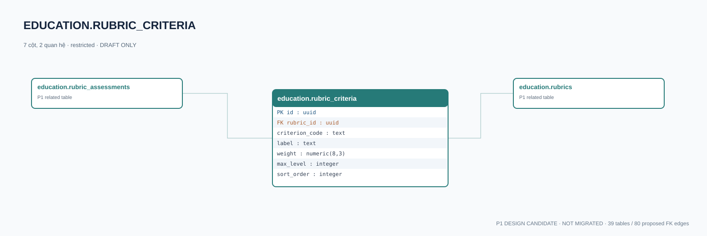

# education.rubric_criteria — P1 DATA DICTIONARY

**Status:** DRAFT / NOT MIGRATED · **Owner:** education · **Data classification:** restricted

Tiêu chí rubric riêng biệt; mức đánh giá cần diễn giải rõ.

## Direct relationship preview

## Columns (7)
| Column | Candidate PostgreSQL type | Key | Nullable | Default |
|---|---|---|---|---|
| `id` | `uuid` | PK | NO | — |
| `rubric_id` | `uuid` | FK → [education.rubrics](education.rubrics.md).`id` | NO | — |
| `criterion_code` | `text` | — | NO | — |
| `label` | `text` | — | NO | — |
| `weight` | `numeric(8,3)` | — | NO | — |
| `max_level` | `integer` | — | NO | — |
| `sort_order` | `integer` | — | NO | — |

## Outbound foreign keys (1)
- `rubric_id` → [education.rubrics](education.rubrics.md).`id` (P1)

## Inbound foreign keys (1)
- [education.rubric_assessments](education.rubric_assessments.md).`rubric_criterion_id` → `id`

## Proposed integrity
**Unique constraints:** `(rubric_id,criterion_code)`

**Check/invariant and domain guard:**
- weight >= 0
- max_level >= 1

**Indexes:** `(rubric_id,sort_order)`

## Required implementation and review
- Evaluate tenant/organization scope and child PII, no direct browser/MCP SQL.
- Verify FK, composite tenant conditions, status machine, optimistic revision, immutable business history, RLS allow-policy **after** SSO source audit.
- Test authorized and unauthorized roles, concurrency and referential integrity in disposable PostgreSQL **only after migration PR exists**.
- Cross-check UI screen IDs/typed API contracts; log P0/P1 decision conflicts before freezing.
