# Student Universe — Database → Backend → Frontend Implementation Contract

**STATUS: DESIGN CANDIDATE; NO physical migration, API implementation, public gallery, runtime inventory or Coin wallet.**

This contract extends existing `docs/database/AGENT_IMPLEMENTATION_REFERENCE.md` and P1 `docs/database/p1/CROSS_LAYER_IMPLEMENTATION.md`. Its 22 proposed tables depend on P0 and the *not-yet-migrated* P1 Commerce schema. **Do not duplicate** `users`, `assets`, `inventory_instances`, `ledger_accounts`, `ledger_transactions` or `ledger_entries`.

## 1. Exact source-of-truth boundaries
| Source of truth | Data | Rule |
|---|---|---|
| `identity.users`, `identity.profiles` (P0) | Global account, private/public-approved display name | Stable KingDragonHub provider subject mapping, no user profile Coin amount |
| `student.student_profiles` (candidate) | Learner-specific alias/stage, limited onboarding | Account type/student status, guardian privacy enforced by server |
| `characters.character_versions` (candidate) | Immutable base character version, compatible rig, approved GLB | Template, not a player-owned character or inventory copy |
| `characters.character_instances` (candidate) | Which playable characters this learner owns | Owner is the authenticated user; no child resale or transfer |
| `commerce.avatar_loadouts` + `avatar_loadout_items` (P1 design) | Which owned cosmetics the character is wearing | `character_loadout_bindings` requires same owner and compatible rig/slots |
| `assets.asset_versions` (P0) | Copyright-approved reusable digital files (GLB, textures, images) | Asset version is **not inventory ownership** |
| `creations.student_projects` + revisions/reviews (candidate) | Learner-authored draft art/characters/simulations | Private storage and moderation; may reference *approved* asset only |
| `commerce.inventory_instances` (P1 design) | User-owned unique item copy | `ownership.inventory_events` adds immutable provenance |
| `ownership.inventory_stacks` (candidate) | Stackable items with quantity/reservation projection | Not currency; never a substitute for ledger |
| `commerce.ledger_* ` (P1 design) | Currency accounting, posted balanced entries | **Only authoritative Coin balance basis**, never `student_profiles.coin` |
| `economy.wallet_balance_projections` (candidate) | Fast read-only balance/held projection | Rebuildable from ledger and holds; source revision checked |
| `economy.reward_grants` (candidate) | Approved idempotent reward receipt | Must link verified result/attempt and posted transaction/event; no blind client grant |
| `progress.*` and `achievements.*` (candidate) | Verified game EXP and badge grants | EXP/grades/rank/Coin separate aggregates |

## 2. Planned authorized app endpoints (NONE IMPLEMENTED)
| Learner screen | Read-model / route proposal | Auth & privacy | Write command proposal (NOT ACTIVE) |
|---|---|---|---|
| My Profile | `GET /v1/me/profile` | Verified SSO session, default private, guardian/teacher views scoped | `PATCH /v1/me/profile/preferences` (version precondition, audit) |
| Character Closet | `GET /v1/me/characters` | Only learner/verified permitted guardian | `POST /v1/me/characters/:id/equip` with item instance ownership and rig checks |
| Asset/Creation Gallery | `GET /v1/me/creations` | Private until reviewed, safe signed URLs | `POST /v1/me/creations/draft` to scoped upload, sandbox scan and review |
| Inventory | `GET /v1/me/inventory` | Owner-only, distinct available/reserved/bound status | `POST /v1/me/items/:id/use` only if rule & stock atomically validated |
| Wallet & Receipts | `GET /v1/me/wallets` | Available / held per currency as projections, last posted revision | Purchase commands only through ShopService, never client balance update |
| Rewards/Badges | `GET /v1/me/awards` | Private-first, verified source and restricted achievements | Server-issued `reward.grant` only after source validation and approved policy |
| Game progress | `GET /v1/me/game-progress` | Result and EXP display, not private academic rubric | Game result consumed by idempotent progress event worker |

**Important:** do not add these routes to `apps/api` while tenant/guardian/role access and P1 schemas have not been approved and actually migrated. `GET /v1/games` currently returns only development sample data.

## 3. Atomic purchase / reward / character pipeline

```mermaid
flowchart LR
  A[SSO principal + tenant + guardian policy] --> B[Domain API validates game, age and item]
  B --> C[Lock wallet account, stock and item ownership]
  C --> D[One verified intent/idempotency key]
  D --> E[Post balanced per-currency ledger entries]
  E --> F[Create inventory entitlement/event + outbox]
  F --> G[Commit DB transaction]
  G --> H[Rebuild balance and inventory read-models]
  H --> I[Frontend sees receipt / owned item]
```

For **official shop purchase**, charge/stock decrement/inventory grant must be consistent under a transaction, or a documented compensation+saga mechanism with explicit risk acceptance. For **rewards**, match result and policy must be verified before posting. Restrict same-currency accounts per transaction, zero-sum posted entries, positive source caps and nonnegative available spend. Reject duplicated idempotency keys and grant attempts by untrusted clients.

## 4. Character/avatar/item consistency
- `character_instances.owner_user_id` and `commerce.avatar_loadouts.owner_user_id` must resolve to the **same** internal user via composite constraints or locked domain service checks, not client `userId`.
- Loadout entries reference `commerce.inventory_instances`; before equip check **item owner**, published Item Version, Asset Version rights, rig compatibility and slot occupancy.
- Full mascot costumes occupy/hide overlapping head/torso/arms/legs slots as configured; never alter competitive hitboxes/physics.
- Pet ownership derives from its inventory instance. `characters.pet_states` stores only optional cosmetic state; no separate untracked owned pet item.
- Learner-created projects start private; versions and review actions are audited. Storage access is scoped and sanitized.

## 5. Parent/teacher/minor authorization
- `student.student_profiles` never stores authoritative password, e-mail, exact DOB, legal name or editable balance.
- A guardian sees learner data only when `identity.guardian_links` is **verified for this learner**, not merely when a FK row exists.
- Teacher grading/classroom access requires active organization membership and actual class scope; teacher is **not** granted wallet spend/edit or direct inventory grants.
- Public profile badges/leaderboard/character gallery require approved age/guardian visibility and withdrawal. No direct messaging/trading between minors by default.
- Client/AI agents must never connect to PostgreSQL; MCP tools remain narrow typed proposals, R3/R4 writes need human approval and Security review.

## 6. Physical migration dependency gates
1. P0 identity/Asset catalog (existing candidate migration) and KingDragonHub SSO/guardian authorization audit.
2. P1-A Education PR #21 migration only if independently approved; P1 Commerce candidate Item/Inventory/Wallet tables require separate reviewed SQL, especially balanced transaction/stock tests.
3. Only then student-specific extra tables and character ownership data, audited without duplicating P1 Commerce functions.
4. RLS allow-policy and least-privilege runtime user tests, negative cross-tenant/guardian/teacher cases, idempotency and concurrent spending.
5. Typed API contract + error/status states + frontend screens + mobile accessibility; no fake wallet/account release claims.

**Change discipline:** source `db/schema/student_universe_extension_candidate.json`, per-table docs, 30-page Draw.io, decisions, downstream schema and tests must all be reviewed together. GitHub CI verifies *design parity*, not financial correctness.
